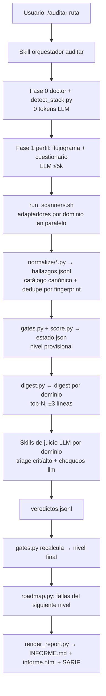
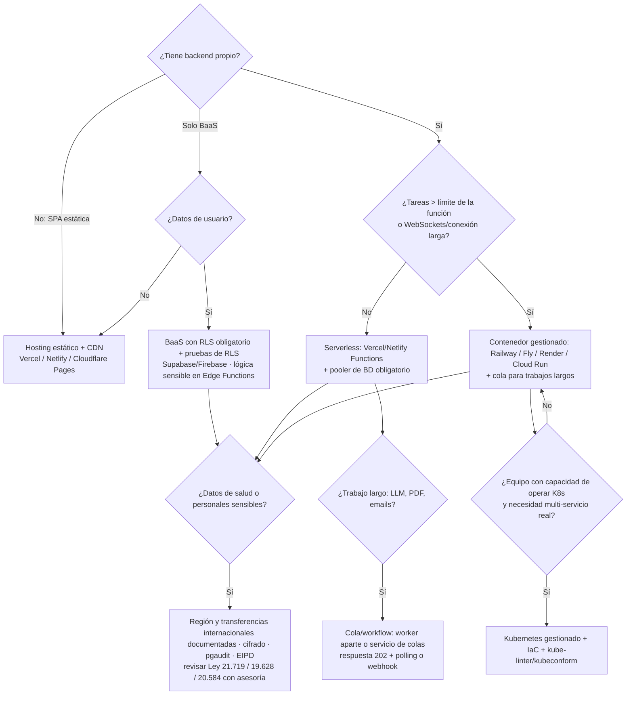

# 09 — Diseño A: "auditor-integral" determinista primero, con el mínimo de tokens

> Fecha: 2026-11-17 · Sellos: **BORRADOR** (arquitectura a revisar), **GUÍA** (procedimientos), **ESTIMACIÓN** (umbrales, presupuestos y pesos que no vienen de una norma). Las cifras de terceros se citan con URL y su estado de verificación se toma de los informes 01-08. Lo que no está verificado se marca **NO VERIFICADO**.

---

## 0. Resumen ejecutivo

- **Tesis del enfoque A:** la evidencia la producen herramientas CLI deterministas que emiten JSON o SARIF. Un normalizador propio, también determinista, la convierte en un único `hallazgos.jsonl` con IDs canónicos. El LLM nunca lee el repositorio completo: recibe un **digest acotado** (top-N por chequeo, deduplicado y con fragmentos de ±3 líneas) y solo hace cuatro cosas: (1) **triagear** falsos positivos de severidad crítica o alta, (2) **juzgar** el pequeño grupo de chequeos que no se pueden automatizar (IDOR, coherencia flujograma↔código, STRIDE, heurísticas de Nielsen), (3) **priorizar** y (4) **explicar** en lenguaje no técnico.
- **Nivel de madurez N1-N5 calculado por script**, no por el LLM: el nivel de un dominio es el N más alto con todas sus compuertas en `pass`, y el nivel global es el **mínimo** entre dominios. Un crítico abierto en seguridad o legal limita el global a N1. Un chequeo que no corrió **nunca** cuenta como aprobado.
- **Tres números separados** que no se mezclan: Nivel (ordinal, por compuerta), Puntaje 0-100 (continuo, informativo) y Cobertura (% de chequeos ejecutados).
- **La usabilidad** se reporta como un **Índice de Usabilidad Automatizado (IUA)**, que **no es SUS**. El SUS solo existe si responden usuarios reales. Sin ellos, el techo del dominio UX es N3 parcial (informe 05).
- **Presupuesto objetivo (ESTIMACIÓN):** ≤ 60 k tokens de LLM para una auditoría completa de un proyecto mediano en modo estándar, con un modo rápido de ≤ 15 k. Se medirá en la validación (§14) contra una línea base de "revisión LLM pura".
- **Estado de este equipo (verificado con `which` el 2026-11-17):** están instalados `gitleaks`, `semgrep`, `osv-scanner`, `zizmor`, `node` v22, `python3` 3.14 y `jq`. Faltan `trivy`, `jscpd`, `knip`, `squawk`, `k6`, `hadolint`, `actionlint` y `checkov`. El MVP (§15, F1) se diseña para correr con lo ya instalado.

---

## 1. Principios de diseño (no negociables)

| # | Principio | Consecuencia concreta |
|---|---|---|
| P1 | **Determinista primero** | Todo chequeo marcado "determinista" en los informes 01-08 se implementa como adaptador CLI → normalizador. El LLM no lo re-evalúa salvo en el triage de críticos y altos. |
| P2 | **El LLM nunca ve el repo entero** | Recibe `digest.json` (≤ 4 k tokens por dominio) más, a demanda, fragmentos concretos por `archivo:línea`. Prohibido leer `node_modules`, `dist` o lockfiles. |
| P3 | **"No ejecutado" ≠ "aprobado"** | Estados posibles: `pass`, `fail`, `no_ejecutado`, `no_aplica`, `manual_pendiente`. Solo `pass` y `no_aplica` desbloquean compuertas. |
| P4 | **Un ID canónico por control** | Las 7 investigaciones repiten controles con IDs distintos (VC-04 = SEC-01 = INF-03 = ECO-02 = DB-05…). `catalogo.yaml` define un ID canónico con alias (GAP-01). |
| P5 | **Perfil de riesgo condicional** | Los dominios de pagos, LLM, salud, email, móvil y BaaS se activan con *flags* detectados o declarados (GAP-00). No se cobran tokens por lo que no aplica. |
| P6 | **Solo lectura e inocuo** | El auditor no escribe en el proyecto auditado (todo va a `.auditoria/`), no toca producción y solo hace DAST o carga contra `localhost` o un staging que el usuario nombre explícitamente. |
| P7 | **Privacidad** | Los secretos se redactan (`gitleaks --redact`). Los digests no incluyen valores de `.env` ni datos de pacientes. Semgrep corre con `--metrics=off`. Ninguna PII sale del equipo hacia el LLM (GAP-24). |
| P8 | **Umbrales en configuración, no en código** | `umbrales.yaml` es editable. Los valores propuestos se marcan ESTIMACIÓN y los decide el investigador (informe 06). |
| P9 | **Reproducible** | Cada ejecución guarda versiones de herramientas, hash del commit y semillas en `run.json`. Dos corridas sobre el mismo commit deben dar el mismo nivel. |

---

## 2. Vista de arquitectura



Regla de oro del flujo: **el LLM entra dos veces (perfil y juicio) y siempre sobre artefactos ya reducidos.** Los veredictos del LLM son un archivo aparte (`veredictos.jsonl`) que `gates.py` combina con los hallazgos deterministas. Así se puede auditar qué decidió la máquina y qué decidió el LLM.

---

## 3. Estructura de carpetas (plugin de Claude Code)

```
auditor-integral/
├── .claude-plugin/
│   └── plugin.json                 # nombre, versión, descripción
├── skills/
│   ├── auditar/SKILL.md            # orquestador (único punto de entrada)
│   ├── auditar-perfil/SKILL.md     # flujograma, alcance, perfil de riesgo
│   ├── auditar-secretos-deps/SKILL.md
│   ├── auditar-codigo/SKILL.md     # calidad, tipos, tests, duplicación
│   ├── auditar-seguridad/SKILL.md  # SAST, authz, IDOR, LLM-sec, CI
│   ├── auditar-bd/SKILL.md         # RLS, migraciones, índices, backups
│   ├── auditar-frontend-ux/SKILL.md
│   ├── auditar-infra-carga/SKILL.md
│   ├── auditar-operacion-legal/SKILL.md  # Ley 21.719/19.628, DR, cuentas, traspaso
│   ├── auditar-triage/SKILL.md     # filtro de falsos positivos (crit/alto)
│   └── auditar-informe/SKILL.md    # redacción final + hoja de ruta
├── commands/
│   ├── auditar.md                  # /auditar [ruta] [--modo rapido|estandar|profundo]
│   ├── auditar-doctor.md           # /auditar-doctor
│   └── auditar-diff.md             # /auditar-diff (re-auditoría incremental)
├── agents/
│   └── juez-dominio.md             # subagente con contexto aislado para juicio LLM
├── hooks/
│   └── hooks.json                  # PreToolUse: bloquea escrituras fuera de .auditoria/
├── bin/
│   └── auditar                     # entrada bash: doctor | scan | gates | report | all
├── scripts/
│   ├── doctor.sh                   # versiones de herramientas → herramientas.json
│   ├── detect_stack.py             # → perfil_tecnico.json (flags)
│   ├── run_scanners.sh             # despacha adaptadores según flags y modo
│   ├── adapters/                   # 1 script por herramienta: ejecuta + guarda crudo
│   │   ├── gitleaks.sh  semgrep.sh  osv.sh  zizmor.sh  trivy.sh
│   │   ├── jscpd.sh  knip.sh  squawk.sh  splinter.sh  rls_probe.sh
│   │   ├── lighthouse.sh  playwright_ux.mjs  k6_smoke.js  headers.sh ...
│   ├── normalize/                  # crudo → esquema común
│   │   ├── sarif.py (genérico)  gitleaks.py  osv.py  splinter.py
│   │   ├── axe.py  lighthouse.py  jscpd.py  knip.py  k6.py  squawk.py ...
│   ├── checks/                     # chequeos deterministas propios (sin herramienta externa)
│   │   ├── env_publicas.py         # VITE_/NEXT_PUBLIC_ con nombres sensibles
│   │   ├── deps_existen.py         # npm view / PyPI JSON + antigüedad
│   │   ├── pooler_bd.py            # host+puerto de DATABASE_URL
│   │   ├── agentes_mcp.py          # .claude/settings*.json, .mcp.json, .cursor/mcp.json
│   │   ├── archivos_clave.py       # lockfile, .env.example, README, CI, migrations
│   │   └── rutas_inventario.py     # extractor ruta→handler para IDOR (alimenta al LLM)
│   ├── digest.py                   # hallazgos → digest por dominio (con tope de tokens)
│   ├── gates.py                    # compuertas → nivel por dominio y global
│   ├── score.py                    # puntaje 0-100 y cobertura
│   ├── iua.py                      # índice de usabilidad automatizado
│   ├── roadmap.py                  # fallas del siguiente nivel → plan ordenado
│   ├── render_report.py            # plantilla → INFORME.md / informe.html / merged.sarif
│   └── token_meter.py              # registra tokens por fase (desde el transcript)
├── config/
│   ├── catalogo.yaml               # chequeos canónicos, alias, dominio, nivel, método
│   ├── umbrales.yaml               # umbrales editables (ESTIMACIÓN marcada)
│   ├── pesos.yaml                  # pesos de severidad para el puntaje
│   └── semgrep/                    # reglas propias "vibe coding"
├── plantillas/
│   ├── INFORME.md.j2  informe.html.j2  cuestionario_perfil.md  checklist_manual.yaml
├── fixtures/                       # proyectos con defectos sembrados para validación
└── tests/                          # pytest de normalizadores, gates y score
```

Salida en el proyecto auditado (sin tocar nada más):

```
<proyecto>/.auditoria/<AAAA-MM-DD_HHMM>/
  run.json  herramientas.json  perfil_tecnico.json  perfil_riesgo.json
  crudo/<herramienta>.(json|sarif|jsonl)
  hallazgos.jsonl  veredictos.jsonl  estado.json
  digest/<dominio>.json  capturas/*.png
  INFORME.md  informe.html  merged.sarif  tokens.json
```

---

## 4. Esquema común de hallazgo (contrato entre scripts y LLM)

```json
{
  "id": "H-7f3a9c",                       
  "check": "SEC-SECRETS-REPO",            
  "alias": ["VC-04","SEC-01","INF-03","ECO-02","DB-05"],
  "dominio": "seguridad",
  "nivel_compuerta": "N1",
  "severidad": "critica",                 
  "estado": "fail",                       
  "fuente": {"herramienta":"gitleaks","version":"8.x","regla":"generic-api-key"},
  "ubicacion": {"archivo":"src/lib/api.ts","linea":12,"commit":"a1b2c3"},
  "evidencia": "const KEY = \"sk-****REDACTED****\"",
  "fingerprint": "sha1(check|archivo|regla|línea normalizada)",
  "metodo": "determinista",               
  "confianza": "alta",
  "triage": null,                         
  "remediacion_ref": "https://github.com/gitleaks/gitleaks",
  "esfuerzo": "S"                         
}
```

- `severidad` ∈ {critica, alta, media, baja, info}. Se mapea desde cada herramienta en `normalize/*.py` (por ejemplo, splinter ERROR→alta o crítica según el lint, WARN→media, INFO→baja; axe critical→alta, serious→media).
- `estado` a nivel de **chequeo** (no de hallazgo) se guarda en `estado.json`: un chequeo es `fail` si tiene ≥ 1 hallazgo no descartado por el triage, `pass` si la herramienta corrió con éxito y no hay hallazgos, y `no_ejecutado` si la herramienta falta, falló o se agotó el tiempo.
- `triage` lo llena solo el LLM: `{"veredicto":"verdadero|falso_positivo|incierto","razon":"…","modelo":"…"}`. Un `incierto` se trata como verdadero (fail-closed).

---

## 5. Catálogo canónico (deduplicación de los informes 01-08)

`config/catalogo.yaml` agrupa los ~250 IDs de los informes en **~95 chequeos canónicos (ESTIMACIÓN; el número exacto sale al construir el catálogo en F0)**. Ejemplo de entrada:

```yaml
- id: SEC-SECRETS-REPO
  titulo: Sin secretos en el repo ni en el historial de git
  alias: [VC-04, SEC-01, INF-03, ECO-02, DB-05]
  dominio: seguridad
  nivel: N1
  severidad_si_falla: critica
  metodo: determinista
  herramientas: [gitleaks, trufflehog]     # la primera disponible
  aplica_si: siempre
  bloquea_global: true                      # un fail limita el global a N1
  fuente: https://www.gitguardian.com/state-of-secrets-sprawl-report-2025
```

Dominios canónicos (10) y su origen:

| Dominio | Prefijo | Fuentes principales |
|---|---|---|
| Idea y requisitos | REQ | ING-02, ING-06, ECO-17, GAP-49 |
| Código y calidad | COD | ING-04/05/09-12/17, VC-17/19 |
| Secretos y dependencias | SUP | VC-04/05/06/10/11, SEC-01..06, SEC-24..28 |
| Seguridad de aplicación | SEC | SEC-07..23, SEC-29..35, VC-07/08/09/20-23/25 |
| Base de datos | BD | DB-01..30, VC-01/02/03/14/16 |
| Frontend y UX | UX | UX-01..20, GAP-18/48 |
| Infraestructura y carga | INF | INF-01..30, ECO-12/15 |
| CI/CD y entrega | CI | ING-07/15/19/21, SEC-25, ECO-13 |
| Operación y DR | OPS | VC-13, DB-23/24, GAP-26..36/42..47/52 |
| Legal y datos personales | LEG | GAP-02..09, SEC-36, VC-24 |

Dominios **condicionales** (se activan por *flag*): `PAG` (pagos: GAP-10..13), `LLM` (SEC-30..34, GAP-20..25), `MAIL` (GAP-14..17), `MOV` (GAP-19), `BAAS` (subconjunto de BD con splinter y sonda anon).

---

## 6. Skills: especificación

Convenciones: cada `SKILL.md` tiene un frontmatter con `name` y `description` (el disparador), unas instrucciones ≤ 150 líneas y referencias a scripts mediante `${CLAUDE_PLUGIN_ROOT}`. Los skills de dominio **no se invocan directamente** por el usuario; los llama el orquestador. Cada uno lee solo su `digest/<dominio>.json`.

| Skill | Disparador (description) | Entradas | Salidas | Deterministas que corre | Qué juzga el LLM | Tope de tokens (ESTIMACIÓN) |
|---|---|---|---|---|---|---|
| **auditar** (orquestador) | "auditar proyecto", "¿está listo para producción?", `/auditar` | ruta, modo | `INFORME.md`, `estado.json` | `bin/auditar all` (fases 0, 2, 3, 5) | Solo coordina; no analiza código | 3 k propios |
| **auditar-perfil** | Llamado por el orquestador en la fase 1 | README, docs/, `perfil_tecnico.json`, respuestas al cuestionario | `perfil_riesgo.json`, `flujograma.mmd` (si no existe, borrador marcado BORRADOR) | `detect_stack.py`, `archivos_clave.py` | Reconstruir el flujograma y el alcance; fijar *flags* (salud, pagos, LLM, menores, UE); preguntar lo no inferible (RPO/RTO, titularidad de cuentas, PITR) | 5 k |
| **auditar-secretos-deps** | Fase 4, dominio SUP | `digest/SUP.json` | veredictos | gitleaks (repo, historial y `dist/`), `env_publicas.py`, osv-scanner, `deps_existen.py`, lockfile-lint, Socket CLI (opcional) | Triage de secretos de prueba frente a reales; solo críticos y altos | 3 k |
| **auditar-codigo** | Fase 4, dominio COD | `digest/COD.json` | veredictos | eslint/biome o ruff, `tsc --noEmit`, pyright, jscpd, knip/deptry, lizard, madge, cobertura existente | Si los tests cubren las rutas de autorización (VC-18), solo con la lista de archivos de test y de rutas | 4 k |
| **auditar-seguridad** | Fase 4, dominio SEC (+LLM si hay *flag*) | `digest/SEC.json`, `rutas_inventario.json` | veredictos | semgrep `p/owasp-top-ten` + reglas propias, bandit, zizmor, `headers.sh` (curl -I), ZAP baseline/nuclei (modo profundo) | **IDOR/BOLA por endpoint** (VC-08, SEC-10/11) a partir del inventario ruta→handler→consulta; fail-closed (SEC-22); STRIDE ligero desde el flujograma (SEC-35); tools del agente (SEC-32) | 12 k |
| **auditar-bd** | Fase 4, dominio BD/BAAS | `digest/BD.json`, `pg_policies.json` | veredictos | splinter (SQL de solo lectura), `rls_probe.sh` (anon sin sesión), squawk, `pooler_bd.py`, consulta de FK sin índice | **Semántica de cada política RLS** frente a la regla de negocio (DB-03); normalización/JSONB (DB-14); transacciones en flujos críticos (DB-16) | 8 k |
| **auditar-frontend-ux** | Fase 4, dominio UX | `digest/UX.json`, ≤ 6 capturas reducidas | veredictos, IUA | `playwright_ux.mjs` (axe, viewports 360/768/1280, Tab-loop, objetivos táctiles, `page.route` 500/timeout, consola), Lighthouse CI ×3, eslint-plugin-jsx-a11y, eslint-plugin-compat | Heurísticas de Nielsen (UX-16) sobre capturas, con la marca **"requiere verificación humana"**; legibilidad de los estados de error (UX-08) | 8 k |
| **auditar-infra-carga** | Fase 4, dominio INF+CI | `digest/INF.json` | veredictos, recomendación de plataforma | hadolint, trivy config/checkov, actionlint, zizmor, k6 smoke (y breakpoint en modo profundo), `pooler_bd.py`, grep de rate limit, Sentry/OTel y `/health` | Si hay trabajo largo dentro del request (INF-06); recorrer el árbol de §11 | 5 k |
| **auditar-operacion-legal** | Fase 4, dominio OPS+LEG | `digest/OPS.json`, respuestas del cuestionario | veredictos, checklist manual | Bearer (inventario de PII), checkdmarc, `archivos_clave.py`, syft + política de licencias | Comparar la política de privacidad con los SDK detectados (GAP-05); runbook no técnico (GAP-43). **No afirma cumplimiento legal**: solo "brechas a revisar con asesoría" | 5 k |
| **auditar-triage** | Llamado por cada skill de dominio cuando hay crit/alto | ≤ 25 hallazgos crit/alto con ±3 líneas | `triage` por hallazgo | — | Verdadero / falso positivo / incierto, con una razón de una línea. Inspirado en fp-check (trailofbits/skills) | 6 k |
| **auditar-informe** | Fase 6 | `estado.json`, `veredictos.jsonl`, `roadmap.json` | `INFORME.md`, `informe.html` | `render_report.py` (el 90 % del informe es plantilla) | Solo redacta el **resumen ejecutivo** (≤ 200 palabras) y traduce las 10 acciones principales a lenguaje no técnico | 4 k |

**Subagente `juez-dominio`:** cada juicio LLM de dominio corre en un subagente con contexto aislado, de modo que el contexto del orquestador no acumule fragmentos de código. Devuelve solo `veredictos.jsonl` (≤ 1 k tokens de retorno).

**Reutilización del ecosistema (informe 07), sin copiar texto:** fp-check, insecure-defaults, supply-chain-risk-auditor y sarif-parsing de `trailofbits/skills`; `supabase/agent-skills` para las buenas prácticas de Postgres; `vercel-labs/web-interface-guidelines` como checklist de UX-16. Se invocan como skills externos opcionales si están instalados. Si no lo están, el auditor funciona igual.

---

## 7. Orquestador: secuencia y modos

```
/auditar <ruta> --modo {rapido|estandar|profundo} [--url http://localhost:5173] [--staging <host nombrado por el usuario>]
```

| Fase | Qué ocurre | LLM | Rápido | Estándar | Profundo |
|---|---|---|---|---|---|
| 0 Doctor y stack | `doctor.sh` + `detect_stack.py` → *flags* | No | ✔ | ✔ | ✔ |
| 1 Perfil | Flujograma, alcance, cuestionario (≤ 8 preguntas) | Sí | Mínimo (sin cuestionario) | ✔ | ✔ |
| 2 Escaneo estático | Adaptadores en paralelo (`xargs -P`), con tiempo límite por herramienta | No | Solo N1-N2 | N1-N4 | N1-N5 |
| 3 Escaneo dinámico | Playwright/axe/Lighthouse, headers, sonda anon, k6 smoke | No | — | Si hay `--url` | + ZAP baseline, nuclei, k6 breakpoint |
| 4 Juicio | Skills de dominio sobre el digest + triage | Sí | Solo triage de críticos | ✔ | ✔ + STRIDE completo |
| 5 Compuertas | `gates.py`, `score.py`, `iua.py`, `roadmap.py` | No | ✔ | ✔ | ✔ |
| 6 Informe | Plantilla + resumen ejecutivo | Sí (mínimo) | ✔ | ✔ | ✔ |

Reglas del orquestador:
1. Si `doctor.sh` informa que falta una herramienta, el chequeo queda `no_ejecutado`. Se le ofrece al usuario el comando de instalación, **pero no se instala nada sin su confirmación**.
2. La fase 3 se ejecuta solo contra `localhost`/`127.0.0.1` o contra un host que el usuario nombre y que se identifique como staging. Nunca contra producción.
3. La sonda anon de Supabase (`rls_probe.sh`) solo hace **lecturas** `GET` con la clave anon que ya es pública en el bundle. Nunca prueba escrituras contra producción; en staging, solo con autorización explícita.
4. Si el total de tokens supera el presupuesto del modo, se recortan primero los hallazgos `media`/`baja` del digest y nunca los críticos.

---

## 8. Scripts: detalles de implementación

### 8.1 `detect_stack.py` → `perfil_tecnico.json` (0 tokens)
Detecta por archivos: `package.json` (React/Vite/Next/Express y `@supabase/supabase-js`, `stripe`, `openai`/`@anthropic-ai/sdk`, `@sentry/*`, `@opentelemetry/*`), `requirements*.txt`/`pyproject.toml`, `supabase/`, `prisma/schema.prisma`, `firebase.json`, `Dockerfile`, `*.tf`, `k8s/`, `.github/workflows/`, `vercel.json`/`netlify.toml`/`fly.toml`, `capacitor.config.*`/`android/`/`ios/`, `.claude/`, `.mcp.json`, `.cursor/`. Emite *flags*: `baas_supabase`, `firebase`, `pagos`, `llm`, `email`, `movil`, `docker`, `iac`, `ci_github`, `ssr`, `serverless`, `agente_ia`.

### 8.2 Adaptadores (comando real + salida)

| Adaptador | Comando base (GUÍA; se ajusta en F1) | Salida |
|---|---|---|
| gitleaks repo | `gitleaks git --redact --report-format json --report-path crudo/gitleaks_git.json <ruta>` | JSON |
| gitleaks bundle | `gitleaks dir --redact -f json -r crudo/gitleaks_dist.json <ruta>/dist` (tras `npm run build` solo si el usuario lo autoriza) | JSON |
| semgrep | `semgrep scan --config p/owasp-top-ten --config config/semgrep --metrics=off --sarif -o crudo/semgrep.sarif` | SARIF |
| osv-scanner | `osv-scanner scan source -r --format json <ruta>` | JSON |
| zizmor | `zizmor --format sarif .github/workflows` (modo `--offline` si no hay red) | SARIF |
| splinter | `psql "$DB_URL_LECTURA" -f splinter.sql -A -F $'\t'` con un rol de solo lectura; alternativa: Supabase MCP `get_advisors` | filas → JSON |
| squawk | `squawk --reporter json supabase/migrations/*.sql` | JSON |
| jscpd | `jscpd --reporters json --output crudo/ src` | JSON |
| knip | `knip --reporter json` | JSON |
| Lighthouse CI | `lhci collect --numberOfRuns=3 && lhci assert` | JSON |
| Playwright UX | `node playwright_ux.mjs --url … --viewports 360,768,1280` | JSON + PNG |
| k6 | `k6 run --summary-export crudo/k6.json k6_smoke.js` | JSON |
| hadolint / trivy config / checkov | `-f sarif` / `--format sarif` / `-o sarif` | SARIF |

Cada adaptador: (a) verifica la presencia de la herramienta; (b) aplica un `timeout` (por defecto 300 s, configurable); (c) guarda el crudo y un `meta` con el código de salida y la versión; (d) **nunca** falla el pipeline completo: el error se registra como `no_ejecutado` con su motivo.

### 8.3 `normalize/` y deduplicación
- `sarif.py` genérico cubre a semgrep, zizmor, hadolint, trivy, checkov, bandit y Bearer. Los demás tienen un normalizador propio de ≤ 80 líneas.
- Mapeo `regla de la herramienta → check canónico` en `catalogo.yaml` (campo `mapea_reglas`). Las reglas sin mapeo van a `COD-OTROS`/`SEC-OTROS` con severidad original.
- Dedupe: el mismo `fingerprint` reportado por dos herramientas (por ejemplo, gitleaks y trufflehog) se fusiona con `fuente` múltiple, lo que **sube la confianza** y no se duplica.

### 8.4 `digest.py` (el corazón del ahorro de tokens)
- Por dominio: los chequeos en `fail` ordenados por (nivel, severidad); **máximo 5 hallazgos por chequeo** y un **conteo del resto**; fragmento de ±3 líneas solo para crit/alto; rutas relativas; secretos redactados.
- Tope duro por dominio: `max_tokens_digest` (por defecto 4.000; se estima con `len(texto)/3.5`, una ESTIMACIÓN a calibrar con el tokenizador en F1).
- Incluye los chequeos `metodo: llm` del dominio con sus **insumos ya preparados** (por ejemplo, `rutas_inventario.json` para IDOR, `pg_policies.json` para DB-03). Así el LLM no tiene que buscar en el repo.

### 8.5 `rutas_inventario.py` (preparar el juicio de IDOR sin leer el repo)
Extrae, con ast-grep o regex por framework (Express/Next route handlers/FastAPI/Supabase Edge Functions), tuplas `{metodo, ruta, archivo:línea, tiene_param_id, llama_a_auth (bool), consulta_filtra_por_usuario (heurística)}`. El LLM solo revisa las filas con `tiene_param_id && !consulta_filtra_por_usuario`. ESTIMACIÓN: eso reduce la revisión a una fracción del total de endpoints; la proporción real se medirá en la validación.

---

## 9. Escala de madurez N1-N5: compuertas medibles por dominio

**Algoritmo (`gates.py`)**
1. Para cada dominio activo *d* y nivel *n*: `ok(d,n) = ∀ chequeo c con c.nivel ≤ n y aplica(c): estado(c) ∈ {pass, no_aplica}`.
2. `Nivel(d) = max{n : ok(d,n)}`, o N0 ("no evaluable") si falla N1.
3. `Nivel_global = min_d Nivel(d)` sobre los dominios activos.
4. **Topes:** cualquier `fail` en un chequeo con `bloquea_global: true` (secretos, RLS deshabilitado, crítico legal) → `Nivel_global ≤ N1` (informe 08). Cualquier crítico abierto en SEC o BD → `≤ N1` para ese dominio.
5. **Cobertura:** si la cobertura de un nivel es < 100 %, ese nivel se reporta como "**N*n* no verificado**" y no se otorga.
6. `manual_pendiente` bloquea solo desde N4 hacia arriba (los chequeos manuales son mayoritariamente de N4-N5). Así un prototipo no se queda en N0 por no tener un simulacro de DR.

**Compuertas mínimas por dominio (extracto; la tabla completa vive en `catalogo.yaml`)**

| Dominio | N1 Prototipo | N2 MVP | N3 Beta | N4 Producción | N5 Escala |
|---|---|---|---|---|---|
| REQ | Flujograma y alcance existen (ING-02) | Criterios de aceptación de flujos críticos (ING-06); código coherente con el flujograma (ECO-17) | ADR + C4 1-2 (ING-13) | Trazabilidad requisito→prueba (ING-18) | Revisión de arquitectura periódica |
| SUP | 0 secretos en repo, historial y bundle; 0 `VITE_/NEXT_PUBLIC_` sensibles; dependencias existen | Lockfile; 0 CVE críticos | Antigüedad mínima de dependencias | 0 CVE altos; SBOM por release | Scorecard ≥ umbral; SLSA L2+ |
| COD | Arranca desde el README | Lint y typecheck limpios; tests de humo | Cobertura ≥ 60 % global (ESTIMACIÓN) y ≥ 80 % en código nuevo (Sonar way); duplicación ≤ 5 % (ESTIMACIÓN); complejidad ≤ 15 (propuesta) | Mutation score ≥ 60 % en críticos (propuesta) | Reglas de capas en CI |
| SEC | Claves privilegiadas solo en el servidor | SAST sin inyección/XSS tras triage; authz por objeto; auth delegada o hash fuerte; STRIDE mínimo | Rate limit en auth y endpoints costosos; headers; CORS explícito; cookies endurecidas; validación por esquema; anti-SSRF | DAST pasivo limpio; logs de seguridad sin PII; red teaming si hay LLM | Pentest humano o bug bounty |
| BD | Sin SQL concatenado; sin credencial privilegiada en el cliente | RLS en el 100 % de las tablas expuestas, sin `USING(true)`; sonda anon negativa; PK; backup diario; buckets privados | Tests de RLS con 2 JWT; squawk limpio; FK indexadas; pooling; paginación | PITR + restauración probada con RTO medido; timeouts por rol; pgaudit | Réplicas/particionamiento; capacity planning |
| UX | Flujo feliz funciona | 0 axe critical; sin scroll horizontal a 360 px; estados de carga y error; `lang`; LCP lab < 4 s | 0 axe serious; teclado completo; 2.5.8 y 2.4.11; E2E en webkit/firefox; SUS medido con IC95 % | CWV de campo p75 (LCP ≤ 2,5 s, INP ≤ 200 ms, CLS ≤ 0,1); SUS ≥ 68; revisión con lector de pantalla | Regresión visual y de a11y por PR; UMUX-Lite continuo |
| INF | Plataforma gestionada | Pooler en serverless; Sentry; `/health`; alerta de presupuesto; k6 smoke aprobado | SLO definidos; λmax conocido (breakpoint); colas para trabajo largo; CDN; región de cómputo = región de la BD | ≥ 2 réplicas; rollback probado; soak/spike; IaC sin críticos; OTel RED | Autoscaling validado; DR/multi-región; chaos |
| CI | — | CI con lint+typecheck+test | Rama protegida + PR; acciones fijadas a SHA | Release semver automatizado; SARIF bloquea críticos | DORA medido |
| OPS | Dueño titular de cuentas y dominio | Previews aislados de prod; guardarraíles del agente IA; límites del plan gratuito conocidos | RPO/RTO declarados; backup externo; runbook no técnico; inventario de secretos | Simulacro de restauración cronometrado; plan de salida del proveedor | Re-auditoría programada |
| LEG (si hay datos personales) | — | Inventario de PII; política de privacidad coherente con los SDK; vigencia de la Ley 21.719 verificada en BCN a la fecha | Base de licitud y consentimiento para datos de salud; exportar/borrar cuenta; transferencias internacionales; plan de brechas | EIPD si corresponde | Validación por asesoría legal |

Fuentes de los umbrales: Sonar way 80 % / 3 % (https://docs.sonarsource.com/sonarqube-server/10.6/user-guide/quality-gates), CWV (https://web.dev/articles/defining-core-web-vitals-thresholds), WCAG 2.2 (https://www.w3.org/TR/WCAG22/), Ley 21.719 (https://www.bcn.cl/balance-legislativo/detalle/ficha_LEY_21719_2024-12-13; la vigencia del 1-12-2026 y la postergación en trámite deben **re-verificarse en BCN el día de cada auditoría**, GAP-08). El resto de los umbrales numéricos son ESTIMACIÓN.

---

## 10. Puntaje por dominio, puntaje global y escala de usabilidad

### 10.1 Puntaje 0-100 (`score.py`, informativo, no decide el nivel)
`Puntaje(d) = 100 × Σ_{c ejecutado} w(c)·[estado=pass] / Σ_{c ejecutado} w(c)`, con `w` = {crítica 10, alta 5, media 2, baja 1} (ESTIMACIÓN, en `pesos.yaml`).
`Cobertura(d) = #ejecutados / #aplicables`.
`Puntaje_global` = media de `Puntaje(d)` ponderada por el número de chequeos aplicables, **siempre acompañada de la cobertura global**. Si la cobertura es < 70 % (ESTIMACIÓN), el informe muestra el puntaje en gris con la leyenda "insuficiente".

Motivo de mantenerlo separado: un puntaje promedio puede ocultar un crítico. El **nivel** (por compuerta) es lo que responde "¿está listo?"; el puntaje solo muestra el progreso entre niveles.

### 10.2 Índice de Usabilidad Automatizado (IUA, 0-100), que **no es SUS**
Componentes deterministas (pesos ESTIMACIÓN, editables):

| Componente | Medición | Peso |
|---|---|---|
| Accesibilidad | 100 − 25·(axe critical) − 10·(axe serious), con piso 0, en flujos críticos | 25 |
| Operabilidad por teclado | % de elementos interactivos alcanzables con Tab y con foco visible (Tab-loop) | 15 |
| Responsive | % de viewports (360/768/1280) sin scroll horizontal + % de objetivos ≥ 24 px | 15 |
| Robustez de estados | % de llamadas de red con estado de carga, vacío y error visibles ante 500/timeout forzado | 15 |
| Rendimiento | Lighthouse perf móvil (mediana de 3) × 100 | 15 |
| Limpieza | 100 si hay 0 errores de consola y 0 errores técnicos visibles; −20 por cada tipo | 15 |

Más un componente **heurístico LLM** reportado **aparte, no sumado**: 10 heurísticas de Nielsen con severidad 0-4 sobre capturas, marcadas "requiere verificación humana".

**SUS real:** el informe incluye la plantilla SUS (10 ítems) y la calculadora con IC95 %. Solo si se ingresan respuestas (≥ 5 usuarios por perfil, informe 05) se reporta un SUS, con la meta de ≥ 68 para N4. Sin respuestas, el informe dice explícitamente: **"SUS: sin datos de usuarios. El IUA no lo reemplaza."** Validar la correlación IUA↔SUS es una pregunta de investigación abierta (ver §14.6), no un supuesto.

---

## 11. Qué infraestructura usar y cuándo (árbol de decisión) — GUÍA

El LLM no "elige" la plataforma: `auditar-infra-carga` recorre este árbol con los *flags* y las respuestas del cuestionario y presenta **opciones justificadas**. La decisión es del dueño.



Datos de apoyo verificados (informe 04): en Vercel, la duración por defecto es de 300 s y el máximo de 800 s en Pro/Enterprise (1.800 s en beta), y el cuerpo de request/response está limitado a 4,5 MB (https://vercel.com/docs/functions/limitations). El puerto 5432 **no** indica por sí solo una conexión directa en Supabase, porque el session pooler también lo usa; hay que mirar el host y el puerto 6543 (https://supabase.com/docs/guides/database/connecting-to-postgres).

**Cuándo escalar (disparadores medibles, GUÍA):** el p95 del SLO incumplido en el smoke o la carga promedio → optimizar consultas e índices antes que la infraestructura; `pg_stat_activity` cerca de `max_connections` → pooler o tamaño de instancia; CPU de la BD sostenida alta con lecturas dominantes → réplica de lectura o caché; trabajo síncrono > 30 % del tiempo de respuesta (ESTIMACIÓN) → cola; gasto unitario > ingreso unitario → FinOps antes de crecer (GAP-21).

---

## 12. Hoja de ruta de crecimiento (`roadmap.py`)

1. Toma los chequeos en `fail`/`no_ejecutado` del **siguiente nivel** de cada dominio y los críticos de cualquier nivel.
2. Los ordena por: (a) `bloquea_global`, (b) severidad, (c) dominio con el nivel más bajo (el cuello de botella del global), (d) esfuerzo (S/M/L, ESTIMACIÓN en el catálogo).
3. Agrupa en **sprints de acción** de "esta semana" (críticos, esfuerzo S), "para llegar a N+1" y "para N+2 (visión)".
4. Cada ítem incluye: qué falla, por qué importa (una línea, en lenguaje no técnico), cómo verificarlo de nuevo (el comando exacto del auditor) y una referencia (doc oficial u OWASP Cheat Sheet).
5. El LLM solo reescribe los textos "por qué importa" (≤ 25 palabras por ítem) para el dueño no programador. El orden lo decide el script.

---

## 13. Formato del informe final

`INFORME.md` (y `informe.html` con el mismo contenido), en español:

1. **Ficha:** proyecto, commit, fecha, modo, versiones de las herramientas, tokens consumidos y duración.
2. **Veredicto en una línea:** "Nivel global **N2 (MVP)**. Cuello de botella: BD (N1). No apto para datos reales de usuarios hasta resolver 3 críticos."
3. **Semáforo por dominio:** tabla con Nivel · Puntaje · Cobertura · críticos abiertos.
4. **Resumen ejecutivo** (≤ 200 palabras, LLM, sello SÍNTESIS).
5. **Críticos y altos** con evidencia (`archivo:línea`, regla y herramienta), veredicto de triage y método (determinista o LLM).
6. **Usabilidad:** IUA con sus componentes, Nielsen (aparte, "requiere verificación humana") y estado del SUS.
7. **Infraestructura recomendada:** ruta en el árbol y opciones justificadas (GUÍA).
8. **Hoja de ruta:** esta semana / N+1 / N+2.
9. **Lo que NO se evaluó:** chequeos `no_ejecutado` y `manual_pendiente`, con el motivo y cómo habilitarlos.
10. **Anexos:** `merged.sarif` (subible a GitHub code scanning), `hallazgos.jsonl` y el checklist manual.

Advertencias fijas al pie: el auditor no certifica seguridad ni cumplimiento legal; los hallazgos LLM son juicios; "axe limpio no equivale a accesible", porque la automatización cubre ~57 % del volumen de issues según Deque (cifra tomada del informe 05).

---

## 14. Protocolo de validación (auditar un proyecto real)

### 14.1 Pregunta y diseño
¿El auditor detecta los defectos reales con una precisión y una sensibilidad aceptables, con un costo de tokens y de tiempo menor que una revisión LLM pura? Diseño: **estudio de exactitud diagnóstica** por chequeo, contra un estándar de referencia, con dos fases.

### 14.2 Fase V1: fixtures con defectos sembrados (estándar de referencia conocido)
- **Fixture A, "vibe-app" propia:** React+Vite+Supabase local (`supabase start`) con defectos sembrados y documentados en `fixtures/vibe-app/GROUND_TRUTH.yaml`: tabla sin RLS, política `USING(true)`, `service_role` en `VITE_`, secreto en el historial de git, dependencia inexistente, `dangerouslySetInnerHTML` con input, endpoint con IDOR, catch vacío en el pago, div clicable sin teclado, scroll horizontal a 360 px, migración con `CREATE INDEX` sin `CONCURRENTLY`, ausencia de rate limit. **Meta: ≥ 40 defectos sembrados distribuidos en los 10 dominios (ESTIMACIÓN)**, más un número similar de "señuelos" correctos para medir falsos positivos.
- **Fixture B, app vulnerable pública** (por ejemplo, OWASP Juice Shop; antes de usarla verificar su licencia y su lista oficial de retos) para contrastar el dominio SEC con una verdad conocida.

### 14.3 Fase V2: proyecto real
Un proyecto que elija el investigador (**no lo autoselecciona el sistema**). Opciones: ResearchIQ (React 18 + Vite + Zustand, mencionado en CLAUDE.md) u otro de `PROYECTOS /`. Estándar de referencia: revisión humana experta e independiente de una **muestra estratificada** de hallazgos (todos los crit/alto + muestra aleatoria de medios), a ciegas respecto al veredicto del triage.

### 14.4 Métricas
| Métrica | Definición | Meta propuesta (ESTIMACIÓN, la decide el investigador) |
|---|---|---|
| Sensibilidad por chequeo | VP / (VP + FN) sobre los defectos sembrados | ≥ 0,90 en críticos; ≥ 0,75 global |
| Precisión (VPP) | VP / (VP + FP), antes y después del triage | ≥ 0,80 después del triage en crit/alto |
| Tasa de FP descartados correctamente por el triage | FP marcados `falso_positivo` / FP totales | Reportar; sin meta previa |
| Concordancia LLM↔humano en chequeos `llm` | κ de Cohen (IC95 %) | κ ≥ 0,60 (ESTIMACIÓN) |
| Exactitud del nivel | Nivel calculado frente al nivel asignado por el experto | Coincidencia exacta o ±0 en el global |
| Tokens | Input + output por fase (`tokens.json`, desde el campo `usage` del transcript; el mecanismo exacto se verifica en F1) | Estándar ≤ 60 k; rápido ≤ 15 k |
| Tiempo | Reloj de pared por fase | Estándar ≤ 15 min sin carga (ESTIMACIÓN) |
| Reproducibilidad | Dos corridas sobre el mismo commit: el mismo nivel y el mismo conjunto de fingerprints deterministas | 100 % en lo determinista |
| Cobertura | % de chequeos aplicables ejecutados | Reportar; ≥ 70 % en estándar |

### 14.5 Comparadores
(a) **Línea base LLM pura:** el mismo proyecto revisado con `/security-review` o con un prompt "audita todo el repo", midiendo tokens, sensibilidad y precisión en el subconjunto SEC. (b) **Solo herramientas sin triage:** para aislar el aporte del LLM a la precisión.

### 14.6 Análisis
Tablas 2×2 por chequeo y por dominio con IC95 % (Wilson). Un estimador agrupado no tiene sentido entre chequeos heterogéneos, así que se reporta por chequeo. Correlación IUA↔SUS solo si hay ≥ 5 usuarios reales que respondan el SUS (es exploratoria; no se usará para calibrar sin una muestra adecuada). Registrar las desviaciones del protocolo. Los resultados en Jamovi/SPSS a partir del CSV que exporta `tests/validacion/export_csv.py`.

### 14.7 Ética y seguridad de la validación
Solo proyectos propios o con autorización escrita. DAST y carga solo en local o staging. Si el proyecto real contiene datos de pacientes, se audita una copia con datos sintéticos; nunca se envían datos reales al LLM (Ley 19.628; revisar la Ley 21.719 según su vigencia a la fecha).

---

## 15. Fases de construcción del propio sistema (MVP → completo)

| Fase | Alcance | Criterios de aceptación (verificables) | Duración (ESTIMACIÓN) |
|---|---|---|---|
| **F0 Esqueleto** | Estructura del plugin, `plugin.json`, esquema de hallazgo (JSON Schema), `catalogo.yaml` deduplicado de 01-08, `umbrales.yaml`, `doctor.sh` | `jsonschema` valida 100 % de los ejemplos; catálogo sin IDs duplicados ni alias huérfanos (test); `/auditar-doctor` lista herramientas y versiones | 1-2 días |
| **F1 MVP determinista (N1-N2)** | `detect_stack.py`; adaptadores con lo **ya instalado** (gitleaks, semgrep, osv-scanner, zizmor) + `env_publicas.py`, `deps_existen.py`, `archivos_clave.py`, `agentes_mcp.py`; `normalize`; `gates.py`; `score.py`; informe por plantilla **sin LLM** | Sobre la Fixture A detecta ≥ 90 % de los defectos sembrados de N1 de SUP; 2 corridas dan resultados idénticos; 0 tokens LLM en las fases 0, 2, 5 y 6 (plantilla); tests de `gates.py` con casos de borde (`no_ejecutado` nunca aprueba) | 3-5 días |
| **F2 BD/BaaS e infra estática** | splinter, `rls_probe.sh`, squawk, `pooler_bd.py`, hadolint, trivy config, actionlint, jscpd, knip, lint/tsc | Detecta RLS deshabilitado, `USING(true)`, `service_role` en el cliente y una migración insegura de la Fixture A; ningún script escribe fuera de `.auditoria/` (test con un hook) | 4-6 días |
| **F3 Frontend/UX** | `playwright_ux.mjs` (axe, viewports, Tab-loop, estados forzados, consola), Lighthouse CI, `iua.py` | IUA reproducible ±2 puntos entre corridas (ESTIMACIÓN); detecta div clicable, scroll horizontal y ausencia de estado de error sembrados | 4-6 días |
| **F4 Juicio LLM + triage** | `digest.py` con tope, `rutas_inventario.py`, subagente `juez-dominio`, skills de dominio, `auditar-triage`, `veredictos.jsonl`; `auditar-perfil` con flujograma | Digest ≤ 4 k tokens por dominio en la Fixture A; IDOR sembrado detectado; precisión después del triage ≥ precisión antes; total en modo estándar ≤ 60 k tokens medidos | 5-8 días |
| **F5 Dinámico, carga, roadmap y operación** | headers, k6 smoke/breakpoint, ZAP baseline/nuclei (profundo), `roadmap.py`, `auditar-operacion-legal`, árbol de infraestructura, HTML y `merged.sarif` | El SARIF fusionado se valida contra el esquema SARIF 2.1.0; la hoja de ruta contiene solo ítems del siguiente nivel + críticos; los chequeos manuales salen en el checklist | 5-7 días |
| **F6 Validación** | Protocolo §14 en las fixtures A y B y en el proyecto real elegido | Métricas de §14.4 reportadas con IC95 %; las metas son orientativas: si no se cumplen, se documenta y se ajusta antes de declarar "v1.0" | 3-5 días |
| **F7 Modo continuo** | `/auditar-diff` (solo archivos cambiados + chequeos afectados), workflow de GitHub Actions que sube el SARIF, re-auditoría programada barata (GAP-52) | La re-auditoría incremental consume ≤ 20 % de los tokens de una completa (ESTIMACIÓN, medido) | 3-4 días |

**Definición de hecho para v1.0:** F0-F6 completas, métricas de validación publicadas en `investigacion/10-validacion.md` y un informe real generado de punta a punta.

---

## 16. Presupuesto de tokens por fase (ESTIMACIÓN, a medir en F4/F6)

| Fase | Rápido | Estándar | Profundo | Palanca de ahorro |
|---|---|---|---|---|
| 0 Doctor y stack | 0 | 0 | 0 | Script |
| 1 Perfil | 1 k | 5 k | 8 k | Lee solo README, docs/ y `perfil_tecnico.json` |
| 2-3 Escaneos | 0 | 0 | 0 | CLI |
| 4 Juicio por dominio | 6 k (solo triage de críticos) | 40 k (≤ 4 k de digest + ≤ 4 k de fragmentos por dominio activo) | 80 k | Digest con tope; subagente aislado; solo filas sospechosas de IDOR |
| 5 Compuertas y roadmap | 0 | 0 | 0 | Script |
| 6 Informe | 2 k | 5 k | 6 k | 90 % plantilla |
| Orquestación | 2 k | 5 k | 6 k | Instrucciones cortas; sin re-leer salidas crudas |
| **Total** | **≈ 11 k** | **≈ 55 k** | **≈ 100 k** | |

Regla anti-desborde: si el triage tiene > 25 crit/alto, se juzgan los 25 de mayor confianza y el resto queda `incierto` (que cuenta como verdadero), con aviso en el informe.

---

## 17. Riesgos del diseño A y mitigaciones

| Riesgo | Mitigación |
|---|---|
| Herramientas ausentes reducen la cobertura | `doctor` + nivel "no verificado" + comandos de instalación sugeridos (requieren confirmación) |
| Las reglas genéricas no ven la lógica de negocio (IDOR, abuso) | Inventario de rutas + juicio LLM focalizado + prueba dinámica con 2 usuarios en N3+ |
| Falsos positivos de SAST que saturan | Triage solo en crit/alto; dedupe por fingerprint; reglas propias calibradas en las fixtures |
| El LLM "aprueba" algo que no debería | El LLM nunca cambia un `fail` determinista a `pass`, salvo que el triage diga `falso_positivo` con una razón registrada; `incierto` = fail |
| Se percibe una certificación | Advertencias fijas; lenguaje "brechas a revisar" en LEG; sin afirmaciones de cumplimiento |
| Cadena de suministro del propio auditor (por ejemplo, el incidente de tags de trivy-action de marzo de 2026, informe 02) | Fijar versiones y hashes de herramientas en `herramientas.lock`; acciones de CI fijadas a SHA |
| El auditor se ejecuta sobre un repo malicioso | Correr los escaneos sin ejecutar código del proyecto; `npm run build` y servidores solo con confirmación del usuario |

---

## 18. Decisiones que quedan para el investigador (no autoseleccionadas)

1. Los umbrales marcados ESTIMACIÓN (cobertura, duplicación, complejidad, mutation, pesos y presupuestos).
2. El proyecto real para la validación (V2).
3. Si se incluye el dominio LEG como bloqueante global o solo informativo para proyectos sin datos personales.
4. Si se adopta el SUS como requisito de N4 en proyectos internos sin usuarios externos.
5. Qué skills externos (trailofbits, supabase, vercel-labs) instalar como dependencias opcionales.
