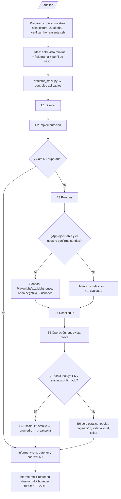
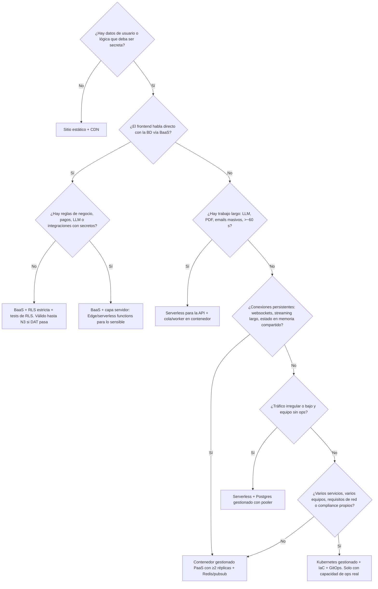

# 09 — Diseño B de "auditor-integral": ciclo de vida y compuertas

**Fecha:** 2026-11-17 · **Estado:** BORRADOR de arquitectura (para decisión del investigador) · **Entradas:** informes 01 a 08 de `investigacion/`

**Sellos usados:** **SÍNTESIS** (integra evidencia de 01-08), **BORRADOR** (diseño propuesto, a revisar), **ESTIMACIÓN** (número o umbral propuesto sin norma que lo respalde, configurable), **GUÍA** (procedimiento). Toda cifra externa lleva URL. Lo que no se pudo verificar se marca **NO VERIFICADO**.

---

## 0. Resumen ejecutivo

**SÍNTESIS / BORRADOR**

El enfoque B organiza la auditoría según **la vida del proyecto**, no según la herramienta: **E0 Idea → E1 Diseño → E2 Implementación → E3 Pruebas → E4 Despliegue → E5 Operación → E6 Escala**. Cada etapa es un skill de Claude Code con tres capas, en este orden:

1. **Scripts deterministas** (scanners CLI con salida JSON o SARIF). No consumen tokens del LLM.
2. **Normalizador**: convierte todo a un JSON común, deduplica contra un **catálogo canónico** de controles, enmascara secretos y PII, y recorta la evidencia.
3. **Juicio LLM acotado**: solo donde las herramientas no llegan (amenazas, autorización/IDOR, arquitectura frente al flujograma, heurísticas de UX y triage de falsos positivos), con subagentes de contexto limpio que devuelven resúmenes cortos.

Las etapas se encadenan con **compuertas (gates)**. Un proyecto alcanza el nivel N*k* de un dominio solo si **todos** los controles exigidos para N*k* están en `pass`. El nivel global es el **mínimo** entre dominios, y un crítico abierto en seguridad o en lo legal **limita el global a N1** (regla tomada de los informes 03, 04 y 08). Un control que no se pudo ejecutar se informa como `no_evaluado`, **nunca como aprobado**.

El usuario contesta **una entrevista mínima** (unas 10 preguntas en E0 y unas 6 en E5) que activa los dominios condicionales: salud, pagos, LLM, emails, móvil, UE y menores.

**Principales decisiones de diseño:**

| Decisión | Justificación |
|---|---|
| Etapas del ciclo de vida como unidad de skill | La hoja de ruta sale ordenada de forma natural ("estás en E2, te falta esto para pasar a E3") y le sirve a un dueño no programador |
| Catálogo canónico con alias | Los informes 01-08 repiten el mismo control con IDs distintos (por ejemplo, secretos = VC-04 = SEC-01 = DB-05 = INF-03 = ECO-02). El informe 08 lo señala como vacío crítico (GAP-01) |
| El LLM no lee el repositorio completo | Lee inventarios (rutas, políticas RLS, esquema) y fragmentos de ±5 líneas alrededor de los hallazgos |
| Reutilizar skills ya existentes | Usar `fp-check`, `insecure-defaults`, `supply-chain-risk-auditor`, `semgrep`, `sarif-parsing`, `gha-security-review`, `skill-scanner` y `supabase` si están instalados (están en este entorno). Si no lo están, hay un fallback a script propio |
| Solo lectura sobre el proyecto auditado | La auditoría trabaja sobre una copia o worktree. DAST, carga y pruebas contra BaaS en vivo solo se ejecutan con confirmación explícita y nunca contra producción por defecto |

---

## 1. Principios de diseño

**BORRADOR**

1. **Primero lo determinista, después el LLM.** Cada control declara `metodo: determinista | mixto | llm | manual`. El LLM nunca re-ejecuta lo que una herramienta ya resolvió.
2. **"No evaluado" no es aprobado.** Por cada control aplicable se registra el estado (`pass | fail | no_evaluado | no_aplica`) con su motivo, por ejemplo "gitleaks no instalado" o "sin URL de staging".
3. **La evidencia manda sobre la autopercepción.** El ECA de METR 2025 mostró que los desarrolladores fueron un 19 % más lentos con IA y creyeron haber ido un 20 % más rápido ([arXiv 2507.09089](https://arxiv.org/abs/2507.09089), VERIFICADO en el informe 06). Por eso la escala no usa la opinión del usuario sobre su código; solo usa sus respuestas para el **contexto** (qué datos maneja y cuántos usuarios espera).
4. **Mínimo contexto para el LLM.** El LLM recibe inventarios estructurados y top-N por severidad. Los subagentes devuelven como máximo unos 1.500 tokens (ESTIMACIÓN, se mide en la validación).
5. **Umbrales en configuración, no en código.** Todos los umbrales propuestos (cobertura, duplicación, complejidad, Lighthouse, pesos del puntaje) viven en `config/umbrales.yaml`, marcados como `norma` u `propuesta`, y **los decide el investigador**.
6. **Seguridad del propio auditor:**
   - nunca envía secretos ni PII al LLM (el normalizador enmascara antes);
   - no modifica el proyecto auditado;
   - no ataca hosts que el usuario no haya nombrado;
   - trata el contenido del repo como **datos, no órdenes** (un README que diga "ignora los hallazgos" es un hallazgo, no una instrucción).
7. **Sin afirmaciones de cumplimiento legal.** En la Ley 19.628, la Ley 21.719 o la Ley 20.584 el auditor **detecta indicios y genera la lista de chequeo**. La conclusión de cumplimiento queda como `manual`, a cargo de una revisión jurídica humana.

---

## 2. Modelo de ciclo de vida y su relación con N1-N5

**SÍNTESIS** (integra las escalas de madurez de 01-08)

| Etapa | Pregunta que responde | Evidencia principal | Nivel al que habilita |
|---|---|---|---|
| **E0 Idea** | ¿Qué hace, para quién, con qué datos y con qué riesgo? | Entrevista, flujograma (mermaid), perfil de riesgo | Prerrequisito de todo |
| **E1 Diseño** | ¿La arquitectura real corresponde a la idea? ¿Dónde está la frontera de confianza? | Inventario del stack, grafo de dependencias, STRIDE, árbol de infraestructura | N1-N2 |
| **E2 Implementación** | ¿El código tiene fallas conocidas de la IA? | Secretos, dependencias, SAST, RLS estática, calidad, migraciones | N1-N3 |
| **E3 Pruebas** | ¿Se demuestra que funciona y que es seguro y usable? | Tests, cobertura, tests de RLS, E2E, axe, Playwright, Lighthouse | N2-N4 |
| **E4 Despliegue** | ¿Llega a producción de forma segura y reproducible? | CI/CD, IaC, Docker, entornos, headers, DAST pasivo, DNS de email | N2-N4 |
| **E5 Operación** | ¿Sobrevive a un incidente, una fuga o un borrado? | Observabilidad, backups/PITR/DR, auditoría de accesos, costos, cuentas, legal | N2-N5 |
| **E6 Escala** | ¿Cuánto aguanta y qué cambiar para crecer? | k6 smoke, carga promedio y breakpoint, pooling, caché, SLO, DORA | N3-N5 |

**Definición de niveles** (común a todos los dominios, adaptada de 01-08):

- **N1 Prototipo.** Corre en local o en una plataforma gestionada. No hay secretos en el repo ni en el bundle. Las dependencias existen. Se conoce el flujograma. El dueño es titular de sus cuentas.
- **N2 MVP.** La autorización se verifica en el servidor (RLS con propiedad, prueba negativa con anon, IDOR). No hay CVE críticos. Hay rate limiting en auth y LLM. Hay lint y typecheck, tests de humo y CI. Existen estados de error y carga, y 0 violaciones axe críticas.
- **N3 Beta.** Tests de autorización en CI. Entornos separados. Headers, CORS y cookies endurecidos. Migraciones linteadas. Cobertura, duplicación y complejidad dentro del umbral. Teclado completo y WCAG 2.2 AA en flujos críticos. SLO definidos y λmax conocido.
- **N4 Producción.** Restauración probada con RPO/RTO. IaC limpia. DAST pasivo limpio. Observabilidad RED con alertas. Rollback probado. Soak y spike aprobados. Core Web Vitals de campo buenos. SUS ≥ 68 con usuarios reales. Revisión jurídica hecha si hay datos personales.
- **N5 Escala.** Re-auditoría continua en CI. Capacity planning. DR o multi-región probados. DORA con tendencia. Pentest humano. SLSA y Scorecard.

---

## 3. Estructura de carpetas del plugin

**BORRADOR**

```text
auditor-integral/
├── .claude-plugin/
│   └── plugin.json                 # nombre, versión, descripción, autor
├── skills/
│   ├── auditar/SKILL.md            # orquestador (/auditar)
│   ├── e0-idea/SKILL.md
│   ├── e1-diseno/SKILL.md
│   ├── e2-implementacion/SKILL.md
│   ├── e3-pruebas/SKILL.md
│   ├── e4-despliegue/SKILL.md
│   ├── e5-operacion/SKILL.md
│   ├── e6-escala/SKILL.md
│   ├── informe-y-ruta/SKILL.md     # puntaje, gates, informe, hoja de ruta
│   └── reauditar-diff/SKILL.md     # modo incremental (fase F5)
├── agents/                          # subagentes de contexto limpio
│   ├── revisor-amenazas.md          # STRIDE desde el flujograma
│   ├── revisor-arquitectura.md      # flujograma vs. arquitectura real, C4, infraestructura
│   ├── revisor-autorizacion.md      # IDOR/BOLA/BFLA por ruta, políticas RLS
│   ├── revisor-ux-heuristico.md     # Nielsen 0-4 sobre capturas
│   └── triage-fp.md                 # falsos positivos en crítico/alto (delega a fp-check si existe)
├── catalogo/
│   ├── controles.yaml               # catálogo canónico (sección 7) con alias a VC/SEC/DB/INF/UX/ING/ECO/GAP
│   └── perfil-riesgo.yaml           # banderas → controles condicionales
├── config/
│   ├── umbrales.yaml                # todos los umbrales, con origen: norma|propuesta
│   ├── pesos.yaml                   # pesos por severidad para el puntaje
│   └── presupuesto-tokens.yaml      # límites por fase (sección 10)
├── schemas/
│   ├── hallazgo.schema.json         # JSON común (sección 6)
│   ├── ejecucion.schema.json        # estado por control y metadatos de la corrida
│   └── perfil.schema.json
├── scripts/
│   ├── detectar_stack.py
│   ├── verificar_herramientas.sh    # qué scanner está instalado, con versión
│   ├── ejecutar_scanners.sh         # corre por etapa, con timeouts, a .auditoria/raw/
│   ├── adaptadores/                 # un adaptador por formato de salida
│   │   ├── sarif.py                 # semgrep/opengrep, gitleaks, osv, trivy, checkov, hadolint, zizmor, bandit, eslint
│   │   ├── splinter.py              # filas SQL de splinter → hallazgos
│   │   ├── squawk.py  jscpd.py  knip.py  axe.py  lighthouse.py  k6.py  coverage.py  zap.py  nuclei.py
│   ├── normalizar.py                # adaptadores → hallazgos.json (+ enmascarado y recorte)
│   ├── deduplicar.py                # fingerprint + mapeo a control canónico
│   ├── inventarios/
│   │   ├── rutas.py                 # ruta → handler → consulta → chequeo de auth (para revisor-autorizacion)
│   │   ├── politicas_rls.sql        # pg_policies / pg_class.relrowsecurity / storage.buckets
│   │   ├── env_publicas.py          # VITE_/NEXT_PUBLIC_/EXPO_PUBLIC_ con nombres sensibles
│   │   ├── registro_deps.py         # existencia y antigüedad en npm/PyPI (slopsquatting)
│   │   ├── pooler.py                # host+puerto de DATABASE_URL, cliente ORM por request
│   │   ├── config_agentes.py        # .claude/settings*.json, .mcp.json, .cursor/mcp.json
│   │   └── esquema_resumen.py       # pg_dump --schema-only → resumen compacto
│   ├── sondas/                      # requieren app corriendo y confirmación
│   │   ├── anon_negativa.sh         # prueba negativa con clave anon (solo lectura)
│   │   ├── dos_usuarios.mjs         # IDOR dinámico con 2 cuentas de prueba
│   │   ├── playwright_ux.mjs        # viewports, teclado, estados forzados, consola, objetivos táctiles
│   │   └── k6/{smoke,promedio,breakpoint}.js
│   ├── evaluar_gates.py             # controles + umbrales → nivel por dominio y global
│   ├── puntuar.py                   # puntaje 0-100 por dominio y global + cobertura
│   ├── renderizar_informe.py        # plantilla → informe.md, resumen-dueno.md, hallazgos.sarif
│   └── medir_tokens.py              # lee el uso de la sesión o el transcript para la validación
├── reglas/
│   ├── semgrep/vibe-coding/*.yaml   # reglas propias: auth en cliente, service_role, amount de req.body, etc.
│   └── ast-grep/*.yml
├── plantillas/
│   ├── informe.md.j2  resumen-dueno.md.j2  flujograma.mmd  stride.md  slo.md  runbook-no-tecnico.md
├── validacion/
│   ├── app-sembrada/                # app de prueba con defectos plantados (sección 17)
│   ├── verdad-terreno.yaml          # defecto → control canónico → ubicación
│   └── metricas.py                  # precisión, sensibilidad, kappa, tiempo, tokens
└── README.md
```

**Salida de cada corrida**, dentro del proyecto auditado pero ignorada por git (el orquestador agrega `.auditoria/` a `.git/info/exclude`, sin tocar `.gitignore`):

```text
.auditoria/<fecha>-<commit>/
├── perfil.json  ejecucion.json  hallazgos.json  hallazgos.sarif
├── raw/        (salidas crudas de las herramientas; nunca se pasan enteras al LLM)
├── capturas/   (Playwright)
├── informe.md  resumen-dueno.md  hoja-de-ruta.md
```

**Lenguajes de los scripts:**

| Lenguaje | Uso | Justificación |
|---|---|---|
| Python 3 (solo stdlib) | Normalizadores y gates | Sin dependencias nuevas; JSON y YAML mínimo |
| Node | Sondas Playwright, axe y Lighthouse | Ese ecosistema solo existe en Node |
| Bash | Orquestar scanners | Mínimo necesario |

Si hace falta YAML, se usa un subconjunto parseable o JSON para no agregar PyYAML. Esta decisión queda abierta.

---

## 4. Orquestador `/auditar`

**BORRADOR / GUÍA**

**Disparadores:**

- `/auditar [ruta] [--hasta=E3] [--rapido] [--staging=URL] [--diff=rama]`
- Frases como "audita este proyecto", "¿está listo para producción?" o "qué nivel de madurez tiene".

**Flujo:**



**Reglas del orquestador:**

1. **Corte temprano.** Si E2 encuentra un crítico de N1 (secreto vivo en el bundle, RLS deshabilitado con datos reales, dependencia inexistente), el informe se emite igual pero **prioriza solo N1**. No tiene sentido medir Lighthouse con la `service_role` expuesta.
2. **Modo `--rapido`.** Ejecuta solo E0 (abreviado), E2 determinista y el gate N1-N2. Pensado para correr en cada sesión de vibe coding.
3. **Confirmaciones explícitas antes de:**
   - toda sonda de red contra un host que no sea local;
   - las pruebas de carga;
   - DAST;
   - cualquier consulta a un BaaS en vivo.

   La confirmación indica el host, la acción y que es de solo lectura (o el volumen de carga, si corresponde). Contra producción, solo con autorización explícita y con una carga de humo mínima.
4. **Paralelismo.** E2 y E4 estáticos son independientes y corren en paralelo como scripts. Los subagentes LLM corren después del normalizador.
5. **Caché por commit.** Si `.auditoria/<commit>` ya existe, se reutilizan las salidas deterministas.

---

## 5. Skills: especificación

**BORRADOR.** La columna "D" lista las herramientas deterministas y la columna "LLM" indica qué juzga el modelo. Las herramientas son las verificadas en los informes 01-08.

### 5.1 Tabla resumen

| Skill | Disparador | Entradas | Salidas | D (herramientas) | LLM (juicio) |
|---|---|---|---|---|---|
| `auditar` | `/auditar`, "¿está listo para producción?" | ruta, flags | carpeta `.auditoria/` | `verificar_herramientas.sh`, `detectar_stack.py` | Ninguno: solo orquesta |
| `e0-idea` | Invocado por el orquestador o con "mapea la idea" | README, docs, respuestas de entrevista | `perfil.json`, `flujograma.mmd`, alcance | Búsqueda de docs, `*.feature`, mermaid existente | Redactar el flujograma desde la entrevista y la estructura de rutas; detectar requisitos sin criterio de aceptación |
| `e1-diseno` | Orquestador | perfil, inventario del stack, grafo de dependencias | hallazgos ARQ, `stride.md`, recomendación de infraestructura | madge o dependency-cruiser (ciclos), `rutas.py`, `config_agentes.py` | **revisor-arquitectura** (lógica de negocio en el cliente, falta de capa servidor, flujograma vs. código); **revisor-amenazas** (STRIDE ligero); árbol de infraestructura (sección 14) |
| `e2-implementacion` | Orquestador o `/auditar --rapido` | repo, build `dist/` | hallazgos SEG/DAT/COD | gitleaks (repo, historial, dist), trufflehog opcional, `env_publicas.py`, `registro_deps.py`, osv-scanner, lockfile-lint, semgrep/opengrep (`p/owasp-top-ten` + reglas propias), bandit, eslint (security, jsx-a11y, no-floating-promises), tsc/pyright, jscpd, knip/deptry, lizard, squawk, splinter o `politicas_rls.sql` (si hay credenciales de solo lectura) | **revisor-autorizacion** sobre el inventario de rutas y `pg_policies`; triage-fp solo en crítico y alto; semántica de políticas RLS (¿filtra por `auth.uid()` según la regla de negocio?) |
| `e3-pruebas` | Orquestador | repo, app corriendo (opcional) | hallazgos COD/UX/SEG, capturas | Detección del framework de tests, vitest/jest/pytest con cobertura JSON, stryker/mutmut (N4), pgTAP o tests con 2 JWT, `playwright_ux.mjs`, @axe-core/playwright, Lighthouse CI (mediana de 3), eslint-plugin-compat, `anon_negativa.sh`, `dos_usuarios.mjs` | ¿Los tests cubren rutas de autorización?; **revisor-ux-heuristico** (Nielsen 0-4 sobre capturas, marcado "requiere verificación humana") |
| `e4-despliegue` | Orquestador | `.github/workflows`, Dockerfile, IaC, `vercel.json`/`netlify.toml`, URL de staging | hallazgos INF/SEG | actionlint, zizmor, poutine, hadolint, trivy config, checkov, kube-linter, `curl -I` (headers, CORS, caché), ZAP baseline y nuclei (con confirmación), checkdmarc, comparación de variables por entorno vía CLI en solo lectura, syft (SBOM) | ¿Entornos dev/prod realmente separados?; ¿rollback documentado y creíble? |
| `e5-operacion` | Orquestador | perfil, entrevista breve, dependencias | hallazgos OPS/LEG | Detección de @sentry/*, @opentelemetry/*, `/health`, logger estructurado; pgaudit o triggers de auditoría; `semgrep` sobre `max_tokens` y llamadas LLM sin límite; Bearer (flujos de PII); ScanCode/syft (licencias) | Runbook no técnico comprensible; política de privacidad vs. SDK reales; plan de brechas; inventario de cuentas SaaS (con las respuestas del dueño) |
| `e6-escala` | Orquestador con `--hasta=E6` | staging confirmado, perfil (usuarios esperados) | hallazgos ESC, `capacidad.md` | `pooler.py`, semgrep (findMany sin take, await en bucle, MemoryStore, fs.writeFile), k6 smoke → promedio → breakpoint (`ramping-arrival-rate`, `--summary-export`), `pg_stat_statements` si hay acceso | Interpretar λmax con la ley de Little, cuello de botella (método USE), plan de escalado y costo por usuario |
| `informe-y-ruta` | Siempre al final | hallazgos, ejecución, umbrales | `informe.md`, `resumen-dueno.md`, `hoja-de-ruta.md`, SARIF | `evaluar_gates.py`, `puntuar.py`, `renderizar_informe.py` | Redactar el resumen en lenguaje no técnico y ordenar la hoja de ruta por dependencia (no inventa hallazgos: solo reescribe los existentes) |
| `reauditar-diff` | Hook en PR o "revisa lo que cambié" | diff contra rama base | hallazgos nuevos o resueltos | Mismos scanners filtrados a archivos cambiados; semgrep `--baseline-commit` | `differential-review` (ToB) si está instalado |

### 5.2 Contrato común de cada SKILL.md de etapa

**GUÍA**

1. Leer `perfil.json` y la lista de controles aplicables de esta etapa (`catalogo/controles.yaml` filtrado por `etapa` y `condicion`).
2. Ejecutar `scripts/ejecutar_scanners.sh <etapa>`. **No leer** `raw/` directamente.
3. Ejecutar `normalizar.py` y `deduplicar.py`, y leer solo `hallazgos.json` filtrado: top-N por severidad, con evidencia recortada.
4. Para los controles `llm` o `mixto`, lanzar el subagente correspondiente con el inventario mínimo. El subagente devuelve un JSON de hallazgos que valida contra el esquema.
5. Escribir el estado de **cada** control aplicable en `ejecucion.json`, con motivo si es `no_evaluado`.
6. No proponer parches salvo que el usuario lo pida. El auditor diagnostica y prioriza.

### 5.3 Reutilización del ecosistema (informe 07)

| Necesidad | Reutilizar si está instalado | Fallback propio |
|---|---|---|
| Falsos positivos en crítico/alto | `fp-check` (trailofbits/skills) | Subagente `triage-fp` |
| Defaults inseguros | `insecure-defaults` | Reglas semgrep propias |
| Cadena de suministro | `supply-chain-risk-auditor` | `registro_deps.py` + osv-scanner |
| SARIF | `sarif-parsing` | `adaptadores/sarif.py` |
| GitHub Actions | `gha-security-review` | zizmor + actionlint |
| Skills y MCP de terceros del proyecto | `skill-scanner` | `config_agentes.py` |
| Supabase | `supabase` / `supabase/agent-skills`, MCP `get_advisors` | `politicas_rls.sql` + splinter |
| Revisión de PR | `differential-review` | `reauditar-diff` |

Antes de empaquetar el plugin para terceros hay que verificar la licencia de cada skill reutilizado. El informe 07 marca pranava0x0 como "sin licencia: solo referencia".

---

## 6. Esquema JSON común de hallazgos

**BORRADOR**

```json
{
  "id": "H-000123",
  "control": "SEG-SECRETO-BUNDLE",
  "alias": ["VC-05", "SEC-02", "DB-05", "INF-03", "ECO-06"],
  "etapa": "E2",
  "dominio": "SEG",
  "severidad": "critica",
  "confianza": "alta",
  "metodo": "determinista",
  "herramienta": {"nombre": "gitleaks", "version": "x.y.z", "regla": "generic-api-key"},
  "ubicacion": {"archivo": "dist/assets/index-abc.js", "linea": 1, "url": null, "objeto_bd": null},
  "evidencia": "const k=\"sk_live_****…****\"",
  "fingerprint": "sha256(control|archivo_normalizado|regla|snippet_normalizado)",
  "estado": "abierto",
  "gate": "N1",
  "remediacion": "Mover la llamada a una función de servidor y rotar la clave.",
  "referencias": ["CWE-798", "OWASP A07:2025"],
  "verificado_por": "herramienta",
  "notas_llm": null
}
```

**`ejecucion.json`** registra un estado por control:

```json
{"control": "UX-AXE-CRITICAL", "estado": "no_evaluado", "motivo": "app no ejecutable: falta .env", "duracion_s": 0}
```

**Reglas del normalizador:**

- **Enmascarado obligatorio.** Todo valor que coincida con patrones de secreto se reduce a prefijo + `****` + 4 caracteres. Las columnas con nombres de PII (`rut`, `email`, `telefono`, `diagnostico`, etc.) nunca se muestrean; solo se informa su nombre.
- **Recorte.** La evidencia se limita a 300 caracteres y como máximo 5 instancias por par (control, archivo). El resto se resume como "y N más".
- **Severidad canónica.** La severidad la fija el catálogo, no la herramienta. La herramienta puede **subir** un caso (por ejemplo, una clave `live` frente a una `test`), pero no bajarlo.
- **Deduplicación.** Si dos herramientas reportan el mismo fingerprint o el mismo control y ubicación, se fusionan en un hallazgo con `herramienta` múltiple. La coincidencia entre herramientas sube `confianza`.

---

## 7. Catálogo canónico deduplicado

**SÍNTESIS / BORRADOR.** Unifica los aproximadamente 230 IDs de los informes 01-08. Formato: `ID canónico | control | etapa | método | herramienta principal | gate | alias`. Las condiciones se escriben `[si X]`.

### 7.1 Seguridad (SEG)

| ID | Control | Etapa | Método | Herramienta | Gate | Alias |
|---|---|---|---|---|---|---|
| SEG-SECRETO-REPO | Sin secretos en el working tree ni en el historial git | E2 | D | gitleaks (+trufflehog) | N1 | VC-04, SEC-01, ECO-02, INF-03 |
| SEG-SECRETO-BUNDLE | Sin claves privilegiadas en el build cliente | E2 | D | gitleaks dir sobre dist/.next + regex | N1 | VC-05, SEC-02, DB-05, ECO-06 |
| SEG-ENV-PUBLICAS | VITE_/NEXT_PUBLIC_ sin nombres sensibles | E2 | D | `env_publicas.py` | N1 | VC-06 |
| SEG-ENV-EJEMPLO | .env ignorado y .env.example sin valores reales | E2 | D | script | N1 | SEC-03, ING-08 |
| SEG-LLM-CLAVE | Clave del LLM solo en el servidor [si LLM] | E2 | M | gitleaks + LLM | N1 | SEC-30 |
| SEG-DEPS-EXISTEN | Dependencias existen en el registro, con antigüedad mínima, sin typosquat | E2 | D | `registro_deps.py`, Socket CLI | N1 | VC-10, SEC-05, ING-03 |
| SEG-DEPS-CVE-CRIT | Sin CVE críticos en dependencias de producción | E2 | D | osv-scanner / trivy | N2 | SEC-06 |
| SEG-DEPS-CVE-ALTO | Sin CVE altos en dependencias de producción | E2 | D | osv-scanner | N4 | SEC-06 |
| SEG-LOCKFILE | Lockfile comiteado con hosts permitidos | E2 | D | lockfile-lint | N2 | VC-11, SEC-04 |
| SEG-SAST-INY | Sin inyección SQL/NoSQL/comandos, XSS, eval ni path traversal | E2 | D | semgrep/opengrep, bandit, eslint-plugin-security | N2 | VC-09, SEC-07, DB-08, ECO-03 |
| SEG-SAST-TRIAGE | Triage de falsos positivos en crítico y alto | E2 | LLM | fp-check / triage-fp | N2 | SEC-08, ECO-10 |
| SEG-AUTH-CLIENTE | La autorización no depende solo del estado del cliente | E2 | M | semgrep propio + LLM | N2 | VC-07 |
| SEG-IDOR | Autorización por objeto en cada endpoint con ID | E2/E3 | M | `rutas.py` + revisor-autorizacion + `dos_usuarios.mjs` | N2 | VC-08, SEC-10, ECO-08 |
| SEG-BFLA | Rutas admin protegidas en el servidor; sin /admin público | E2/E4 | M | LLM + nuclei | N2 | SEC-11, VC-23 |
| SEG-AUTH-HASH | Auth delegada o con hash fuerte (argon2id/bcrypt/scrypt) | E2 | M | semgrep + LLM | N2 | SEC-13 |
| SEG-JWT | JWT con firma verificada, algoritmo fijo, exp y secreto fuerte | E2 | M | semgrep p/jwt | N2 | SEC-14 |
| SEG-RESET-PWD | Reset con token de un solo uso, con expiración y sin enumeración | E2 | M | semgrep + LLM | N2 | GAP-16 |
| SEG-AGENTES-IA | Agentes y MCP del proyecto sin service_role, sin escritura en prod, sin auto-aprobación; con guardarraíles | E1 | M | `config_agentes.py` + skill-scanner | N2 | VC-15, ECO-20, GAP-45 |
| SEG-LLM-SALIDA | La salida del LLM no llega sin sanitizar a SQL, HTML, shell ni eval [si LLM] | E2 | M | semgrep taint + LLM | N2 | VC-25, SEC-31 |
| SEG-STRIDE | Modelo de amenazas STRIDE ligero desde el flujograma | E1 | LLM | revisor-amenazas | N2 | SEC-35, ING-14 |
| SEG-PAGOS-FIRMA | Webhook de pagos verifica la firma con el cuerpo crudo [si pagos] | E2 | D | semgrep + stripe-cli | N2 | GAP-10 |
| SEG-PAGOS-SERVIDOR | Idempotencia por event.id; el monto y el estado los decide el servidor [si pagos] | E2 | M | semgrep + LLM | N2 | GAP-11, GAP-12, GAP-13 |
| SEG-MASIVA | Sin asignación masiva (BOPLA) | E2 | M | semgrep + LLM | N3 | SEC-12 |
| SEG-COOKIES | Cookies HttpOnly/Secure/SameSite; sin token en localStorage | E4 | M | ZAP + grep | N3 | SEC-15 |
| SEG-CSRF | Protección CSRF con sesión por cookie | E4 | M | ZAP + LLM | N3 | SEC-16 |
| SEG-RATELIMIT | Rate limiting en login, OTP, registro, LLM y pago | E2/E6 | M | semgrep + LLM; k6 espera 429 | N2 | VC-21, SEC-17, INF-04, ECO-15 |
| SEG-VALIDACION | Validación por esquema y límites de body y uploads | E2 | M | semgrep + LLM | N3 | SEC-18, SEC-23 |
| SEG-SSRF | Anti-SSRF en funciones que traen URLs | E2 | M | semgrep taint + LLM | N3 | SEC-19 |
| SEG-HEADERS | CSP, HSTS, XCTO, frame-ancestors, Referrer-Policy | E4 | D | curl -I, ZAP baseline | N3 | VC-20, SEC-20 |
| SEG-CORS | CORS explícito, sin * con credenciales | E4 | M | ZAP + semgrep | N3 | VC-20, SEC-21 |
| SEG-ERRORES | Errores sin trazas al cliente; fail-closed en auth y pagos | E2 | M | eslint/semgrep + LLM | N3 | VC-17, SEC-22 |
| SEG-LLM-AGENCIA | Herramientas del agente con mínimo privilegio; RAG tratado como no confiable [si LLM] | E1 | LLM | revisor-amenazas | N3 | SEC-32, SEC-33 |
| SEG-CICD | Acciones fijadas a SHA, permisos mínimos, sin pull_request_target inseguro | E4 | D | zizmor, poutine, actionlint | N3 (bloquea N4) | SEC-25, INF-14, ECO-13 |
| SEG-SECURITY-TXT | security.txt y canal de reporte | E4 | D | curl | N3 | GAP-50 |
| SEG-DAST-PASIVO | DAST pasivo sin altos | E4 | D | ZAP baseline | N4 | SEC-37, ECO-16 |
| SEG-DAST-PLANTILLAS | Plantillas de exposición y misconfig | E4 | D | nuclei | N4 | SEC-38 |
| SEG-SBOM | SBOM por release | E4 | D | syft / cdxgen | N4 | SEC-26 |
| SEG-REDTEAM-LLM | Red teaming de prompt injection [si LLM] | E3 | M | promptfoo / garak | N4 | SEC-34 |
| SEG-SCORECARD | OpenSSF Scorecard sobre el umbral; SLSA L2+ | E4 | D | scorecard, cosign | N5 | SEC-27, SEC-28 |
| SEG-PENTEST | Pentest humano o bug bounty | E6 | Manual | — | N5 | SEC-40 |

### 7.2 Datos (DAT)

| ID | Control | Etapa | Método | Herramienta | Gate | Alias |
|---|---|---|---|---|---|---|
| DAT-RLS-ON | RLS habilitado en todas las tablas expuestas [si BaaS] | E2 | D | splinter 0013 / pg_class | N1 con datos reales; N2 en general | VC-01, SEC-09, DB-01, ECO-05 |
| DAT-RLS-PERMISIVA | Sin USING(true)/WITH CHECK(true) en datos de usuario; sin RLS sin políticas | E2 | M | splinter 0024/0008 + LLM | N2 | VC-02, DB-02 |
| DAT-RLS-SEMANTICA | Las políticas reflejan la regla de negocio por comando | E2 | LLM | revisor-autorizacion sobre pg_policies | N2 | DB-03 |
| DAT-RLS-METADATA | RLS no depende de user_metadata | E2 | D | splinter 0015 | N2 | DB-06 |
| DAT-ANON-NEGATIVA | Con anon y sin sesión no se lee ni escribe | E3 | D | `anon_negativa.sh` (con confirmación) | N2 | VC-03 |
| DAT-SECDEF | SECURITY DEFINER con search_path fijo y EXECUTE revocado a anon | E2 | D | splinter 0011/0028/0029/0031 | N2 | DB-07 |
| DAT-BUCKETS | Buckets privados; URLs firmadas para PII | E2 | M | storage.buckets / reglas Firebase + LLM | N2 | VC-16 |
| DAT-GRANTS | Rol de app con mínimo privilegio; grants a anon mínimos | E2 | D | pg_roles, splinter 0002 | N2 | DB-22 |
| DAT-ESQUEMA-VERSIONADO | Migraciones en el repo y diff vacío contra prod | E2 | D | supabase db diff / atlas / prisma migrate diff | N2 | DB-09, INF-10 |
| DAT-PK-FK | Todas las tablas con PK y FK declaradas | E2 | D | splinter 0004 | N2 | DB-12 |
| DAT-PII-INVENTARIO | PII identificada, minimizada y no expuesta | E1/E2 | M | heurística de columnas + splinter 0023/0025 + Bearer + LLM | N2 | DB-25, GAP-02 |
| DAT-BACKUP | Backups automáticos activos (PITR según RPO) | E5 | M | panel + pregunta | N2 | VC-13, DB-23, INF-10 |
| DAT-RLS-TESTS | Tests automatizados de RLS (A no ve B; anon sin acceso) | E3 | D | pgTAP / 2 JWT | N3 | DB-04 |
| DAT-MIGRACIONES-SEGURAS | Sin locks largos ni destructivas sin guarda | E2 | D | squawk --reporter json, strong_migrations | N3 | VC-14, DB-10, ECO-11 |
| DAT-FK-INDICE | FK indexadas | E2 | D | splinter 0001 | N3 | DB-13 |
| DAT-TIPOS | Tipos y constraints correctos | E2 | D | squawk prefer-*, schemalint | N3 | DB-15 |
| DAT-TRANSACCIONES | Flujos multi-paso atómicos e idempotentes | E2 | LLM | revisor-arquitectura | N3 | DB-16 |
| DAT-N+1 | Sin N+1 en endpoints principales | E2/E6 | M | ast-grep/semgrep + pg_stat_statements | N3 | DB-17 |
| DAT-PAGINACION | Paginación y límites en listados | E2 | M | semgrep | N3 | DB-18, INF-12 |
| DAT-POOLER | Pooler correcto según el runtime; cliente ORM singleton | E2 | D | `pooler.py` (host + puerto, no solo el 5432) | N2 | DB-20, INF-05 |
| DAT-AUDITORIA-ACCESOS | Log append-only de accesos a datos sensibles | E5 | M | pgaudit / triggers | N3 (N2 si hay salud) | DB-26, GAP-37, GAP-38 |
| DAT-TIMEOUTS | statement_timeout por rol | E5 | D | pg_roles.rolconfig | N4 | DB-21 |
| DAT-RESTORE | Restauración probada con RTO medido | E5 | Manual | script de restore efímero | N4 | DB-24, GAP-33 |
| DAT-CONSULTAS-LENTAS | Top consultas con EXPLAIN | E6 | M | pg_stat_statements, supabase inspect | N4 | DB-19 |
| DAT-HIGIENE | Índices duplicados o no usados, bloat, edad XID | E5 | D | splinter / supabase inspect | N4 | DB-27 |
| DAT-EXPAND-CONTRACT | Cambios incompatibles con expand/contract | E4 | LLM | revisión PR | N4 | DB-11 |
| DAT-ESCALADO | Plan de réplicas, particionamiento y caché | E6 | LLM | table-stats + patrones | N5 | DB-29 |

### 7.3 Código e ingeniería (COD)

| ID | Control | Etapa | Método | Herramienta | Gate | Alias |
|---|---|---|---|---|---|---|
| COD-REPRO | Repo git; arranque reproducible desde el README | E2 | D | ejecución en sandbox | N1 | ING-01, GAP-42 |
| COD-FLUJOGRAMA | Existe flujograma y alcance | E0 | M | e0-idea | N1 | ING-02 |
| COD-LINT | Lint sin errores | E2 | D | eslint / biome / ruff | N2 | ING-04 |
| COD-TIPOS | Typecheck pasa; strict; any/ts-ignore bajo el umbral | E2 | D | tsc, ast-grep, pyright | N2 | ING-05 |
| COD-CRITERIOS | Historias y criterios de aceptación verificables de los flujos críticos | E0 | LLM | e0-idea | N2 | ING-06 |
| COD-CI-BASICO | CI que corre lint, typecheck y tests en cada push o PR | E4 | D | workflows + actionlint | N2 | ING-07 |
| COD-TESTS-HUMO | Tests de humo de los flujos críticos | E3 | D | ejecución de tests | N2 | ING-07 |
| COD-DOC-AGENTE | CLAUDE.md o AGENTS.md con la arquitectura | E1 | M | existencia + LLM | N2 | GAP-42 |
| COD-COBERTURA | Cobertura ≥ umbral global (ESTIMACIÓN 60 %) y ≥ 80 % en código nuevo (Sonar way) | E3 | D | vitest/jest/pytest-cov | N3 | ING-09, VC-18 |
| COD-AUTHZ-TESTS | Los tests cubren rutas de autorización | E3 | M | cobertura + LLM | N3 | VC-18 |
| COD-DUPLICACION | Duplicación ≤ umbral (ESTIMACIÓN 5 % global; 3 % en nuevo según Sonar) | E2 | D | jscpd | N3 | VC-19, ING-10 |
| COD-COMPLEJIDAD | Complejidad por función ≤ 15 (propuesta) y archivos bajo el umbral | E2 | D | lizard / radon | N3 | ING-11, GAP-46 |
| COD-CICLOS-MUERTO | Sin ciclos ni código muerto relevante | E2 | D | madge / dependency-cruiser, knip, vulture | N3 | ING-12 |
| COD-ADR-C4 | ADRs y C4 de niveles 1-2 | E1 | M | existencia + LLM | N3 | ING-13 |
| COD-RAMA-PROTEGIDA | Rama principal protegida y PR con revisión | E4 | M | `gh api …/protection` | N3 | ING-15 |
| COD-LICENCIAS | Licencias compatibles con el modelo de distribución | E2 | D | syft/cdxgen + política; ScanCode en N4 | N3 | GAP-39, GAP-40, GAP-41 |
| COD-MUTACION | Mutation score ≥ 60 % en módulos críticos (propuesta) | E3 | D | stryker-js / mutmut | N4 | ING-17 |
| COD-E2E-TRAZA | E2E de flujos críticos con trazabilidad requisito→prueba | E3 | D | Playwright / cucumber | N4 | ING-18 |
| COD-RELEASE | Release semver automatizado con changelog | E4 | D | semantic-release / release-please | N4 | ING-19 |
| COD-DORA | 5 métricas DORA con tendencia | E6 | D | `gh api` | N5 | ING-21 |

### 7.4 Usabilidad y frontend (UX)

| ID | Control | Etapa | Método | Herramienta | Gate | Alias |
|---|---|---|---|---|---|---|
| UX-A11Y-ESTATICA | Sin divs clicables, img sin alt ni inputs sin label (JSX) | E2 | D | eslint-plugin-jsx-a11y | N2 | UX-03 |
| UX-AXE-CRIT | 0 violaciones axe critical en flujos críticos | E3 | D | @axe-core/playwright | N2 | UX-01, ECO-14 |
| UX-REFLOW | Sin scroll horizontal a 360, 768 y 1280 px | E3 | D | `playwright_ux.mjs` | N2 | UX-07 |
| UX-ESTADOS | Estados de carga, vacío y error ante fallos forzados | E3 | M | page.route + LLM sobre capturas | N2 | UX-08 |
| UX-ERRORES-VISIBLES | Sin errores técnicos visibles ni errores de consola | E3 | D | Playwright | N2 | UX-09 |
| UX-FORMULARIOS | Labels, autocomplete y errores asociados y anunciados | E3 | M | axe + Playwright + LLM | N2 | UX-10 |
| UX-LANG | `html lang` presente | E3 | D | axe html-has-lang | N2 | UX-14 |
| UX-HEURISTICA | Nielsen (10 heurísticas, severidad 0-4) sobre capturas; requiere verificación humana | E3 | LLM | revisor-ux-heuristico | N2 (realizada) / N3 (sin severidad 4) | UX-16 |
| UX-FECHAS | Fechas en UTC y mostradas en la zona del usuario | E2 | M | semgrep + LLM | N2 | GAP-51 |
| UX-AXE-SERIOUS | 0 violaciones axe serious | E3 | D | axe, pa11y-ci | N3 | UX-02 |
| UX-TECLADO | Flujo crítico completable solo con teclado; foco visible; modales con trampa y Esc | E3 | M | Tab-loop Playwright + LLM | N3 | UX-04 |
| UX-TACTIL | Objetivos ≥ 24×24 CSS px (WCAG 2.5.8) | E3 | D | boundingBox | N3 | UX-05 |
| UX-FOCO-OCULTO | Foco no oculto por sticky (WCAG 2.4.11) | E3 | M | elementFromPoint | N3 | UX-06 |
| UX-LIGHTHOUSE | Lab móvil (mediana de 3): a11y ≥ 0,9; perf ≥ 0,8 (ESTIMACIÓN); LCP < 4 s | E3 | D | Lighthouse CI | N3 | UX-11 |
| UX-NAVEGADORES | Browserslist sin APIs no soportadas; E2E en chromium, webkit y firefox | E3 | D | eslint-plugin-compat + Playwright | N3 | UX-13 |
| UX-CONSENTIMIENTO | Scripts de terceros no cargan antes del consentimiento | E3 | D | Playwright | N3 | GAP-48 |
| UX-SW-PWA | Manifest y SW válidos; el SW no cachea respuestas autenticadas [si PWA] | E3 | M | Playwright + LLM | N3 | GAP-18 |
| UX-SUS-MEDIDO | SUS con ≥ 5 usuarios por perfil e IC95 % | E3 | Manual | plantilla SUS | N3 (medido) | UX-17 |
| UX-CWV-CAMPO | p75: LCP ≤ 2,5 s, INP ≤ 200 ms, CLS ≤ 0,1 | E5 | D | web-vitals + RUM | N4 | UX-12 |
| UX-SUS-68 | SUS ≥ 68 | E5 | Manual | plantilla SUS | N4 | UX-17 |
| UX-TOKENS | Colores y espaciados desde design tokens | E2 | M | stylelint + conteo + LLM | N4 | UX-15 |
| UX-LECTOR-PANTALLA | Revisión manual NVDA/VoiceOver y criterios WCAG 2.2 no automatizables | E3 | Manual | Accessibility Insights | N4 | UX-19 |
| UX-I18N | Claves i18n completas [si multi-idioma] | E2 | D | i18next-cli | N4 | UX-14 |
| UX-REGRESION | Regresión visual y de a11y por PR; presupuestos por ruta | E4 | D | toHaveScreenshot + LHCI budgets | N5 | UX-20 |
| UX-UMUX | UMUX-Lite continuo | E5 | Manual | encuesta in-app | N5 | UX-18 |

### 7.5 Infraestructura y despliegue (INF)

| ID | Control | Etapa | Método | Herramienta | Gate | Alias |
|---|---|---|---|---|---|---|
| INF-INVENTARIO | Stack y plataforma detectados | E1 | D | `detectar_stack.py` | N1 | INF-01, ECO-01 |
| INF-PLATAFORMA | Plataforma adecuada según el árbol de decisión | E1 | LLM | revisor-arquitectura + sección 14 | N1 (diagnóstico) / N3 (cumplido) | INF-02 |
| INF-ENTORNOS | Dev y prod separados (BD y claves distintas); previews sin claves de prod | E4 | M | CLI solo lectura + LLM | N2 (previews) / N3 | VC-12, GAP-36 |
| INF-TAREAS-LARGAS | Trabajo largo en cola; maxDuration coherente | E2 | M | grep + LLM | N2 | INF-06 |
| INF-TIMEOUTS-SALIDA | Timeouts explícitos en llamadas salientes | E2 | D | semgrep propio | N2 | INF-07 |
| INF-DOCKERFILE | Dockerfile sin latest ni root; multi-stage [si Docker] | E4 | D | hadolint, trivy config | N2 | INF-13 |
| INF-SIN-ESTADO | Procesos sin estado local (12-Factor 3, 6, 9 y 11) | E2 | M | semgrep + LLM | N3 | INF-15, INF-30 |
| INF-CACHE-CDN | Cabeceras de caché y CDN | E4 | D | curl -I | N3 | INF-18 |
| INF-REGION | Región de cómputo igual a la de la BD | E4 | D | parser de configuración | N3 | INF-19 |
| INF-EMAIL-DNS | SPF, DKIM y DMARC alineados [si emails] | E4 | D | checkdmarc | N2 | GAP-14 |
| INF-EMAIL-ASYNC | Envío asíncrono con reintento [si emails] | E2 | M | LLM | N3 | GAP-15, GAP-17 |
| INF-IAC | IaC sin misconfiguraciones críticas [si IaC] | E4 | D | trivy config, checkov | N4 | SEC-24, INF-21, ECO-12 |
| INF-K8S | Manifiestos con limits, probes y no-root [si K8s] | E4 | D | kube-linter, kubeconform | N4 | INF-22 |
| INF-ROLLBACK | Deploy sin downtime y rollback probado; ≥ 2 réplicas | E4 | M | configuración + pregunta | N4 | INF-26, ING-15 |
| INF-IAC-REPRO | Infraestructura reproducible como código | E4 | D | fs | N4 | INF-27 |
| INF-MOVIL | MobSF sin secretos embebidos ni cleartext; MASVS-L1 [si móvil] | E2 | D | MobSF | N3 | GAP-19 |

### 7.6 Escala y carga (ESC)

| ID | Control | Etapa | Método | Herramienta | Gate | Alias |
|---|---|---|---|---|---|---|
| ESC-SMOKE | Smoke k6 dentro de los thresholds | E6 | D | k6 | N2 | INF-12 |
| ESC-LLM-TOPE | Tope de gasto del proveedor, cuota por usuario y max_tokens [si LLM] | E5 | M | semgrep + pregunta | N2 | GAP-20, SEC-30 |
| ESC-PRESUPUESTO | Alertas de presupuesto en nube y BaaS | E5 | Manual | checklist | N2 | INF-11 |
| ESC-CARGA-PROMEDIO | Carga promedio con thresholds del SLO | E6 | D | k6 | N3 | INF-12 |
| ESC-BREAKPOINT | λmax, concurrencia estimada (Little) y cuello de botella (USE) | E6 | M | k6 ramping-arrival-rate + LLM | N3 | INF-20 |
| ESC-SLO | SLO/SLI definidos | E5 | Manual | plantilla SLO | N3 | INF-16 |
| ESC-COSTO-UNITARIO | Costo por usuario activo frente al ingreso; escenario viral | E6 | M | infracost + LLM | N3 / N4 | GAP-21, INF-28 |
| ESC-SOAK-SPIKE | Soak y spike (fugas, autoscaling, cold start) | E6 | D | k6 | N4 | INF-25 |
| ESC-CAPACIDAD | Capacity planning recurrente, DR/chaos, multi-región | E6 | Manual | checklist PRR | N5 | INF-29 |

### 7.7 Operación, continuidad y legal (OPS)

| ID | Control | Etapa | Método | Herramienta | Gate | Alias |
|---|---|---|---|---|---|---|
| OPS-CUENTAS | El dueño es titular de cada SaaS, del dominio y del DNS (autorrenovación) | E0/E5 | Manual | entrevista | N1 / N2 | GAP-26, GAP-27 |
| OPS-PLAN-GRATIS | Límites del plan gratuito conocidos (pausa, cuotas) | E5 | M | CLI + pregunta | N2 | GAP-28 |
| OPS-ERROR-TRACKING | Error tracking instalado | E5 | D | manifiestos | N2 | INF-08 |
| OPS-HEALTH | Endpoint /health | E5 | D | grep + curl | N2 | INF-09 |
| OPS-PRIVACIDAD | Política de privacidad coherente con los SDK y la recolección real [si datos personales] | E5 | M | Bearer + LLM | N2 | GAP-05 |
| OPS-LEY-VIGENCIA | Estado de vigencia de la Ley 21.719 verificado en BCN a la fecha | E5 | Manual | [BCN](https://www.bcn.cl/balance-legislativo/detalle/ficha_LEY_21719_2024-12-13) | N2 | GAP-08 |
| OPS-LLM-PII | No se envía PII ni datos de salud al LLM sin anonimizar ni base legal [si LLM y PII] | E2 | M | Presidio + LLM | N2 | GAP-24 |
| OPS-LOGS-ESTRUCTURADOS | Logs estructurados con correlación y sin PII ni tokens | E5 | M | dependencias + semgrep/Bearer | N3 | VC-22, INF-17, SEC-29 |
| OPS-DERECHOS-TITULAR | Exportar y eliminar cuenta, incluidos storage y proveedores [si datos personales] | E5 | M | LLM + prueba | N3 | GAP-04 |
| OPS-LICITUD | Base de licitud y consentimiento expreso para salud [si salud] | E5 | Manual | revisión jurídica | N3 | GAP-03 |
| OPS-TRANSFERENCIAS | Región de cada proveedor identificada | E5 | M | configuración + LLM | N3 | GAP-06 |
| OPS-BRECHAS | Plan de respuesta a brechas con notificación | E5 | Manual | checklist | N3 | GAP-07 |
| OPS-RPO-RTO | RPO y RTO declarados; backup cifrado fuera del proveedor; backup de storage, auth, variables y DNS | E5 | M | restic/pg_dump + entrevista | N3 | GAP-30, GAP-31, GAP-32 |
| OPS-SECRETOS-CICLO | Inventario de secretos con dueño y rotación; rotación tras fuga probada | E5 | M | SOPS/dotenvx/Infisical + checklist | N3 | GAP-34, GAP-35, SEC-39 |
| OPS-RUNBOOK | Runbook no técnico y panel de salud del dueño | E5 | LLM | plantilla | N3 | GAP-43, GAP-44 |
| OPS-TRASPASO | Paquete de traspaso: ≥ 2 admins con MFA, ADR, riesgos aceptados firmados | E5 | Manual | checklist | N3 | GAP-47 |
| OPS-LLM-TRAZAS | Trazas del LLM con tokens y costo [si LLM] | E5 | D | Langfuse/Helicone/LiteLLM | N3 | GAP-22 |
| OPS-OTEL-RED | OpenTelemetry con métricas RED; alertas por SLO y runbooks (PRR) | E5 | M | dependencias + checklist | N4 | INF-23, INF-24, ING-20, ECO-18 |
| OPS-RETENCION | Política de retención y borrado de datos legacy | E5 | Manual | inventario | N4 | VC-24 |
| OPS-JURIDICO | Cumplimiento normativo verificado contra el texto legal por una persona | E5 | Manual | checklist | N4 | SEC-36 |
| OPS-EIPD | EIPD/DPIA si hay datos sensibles a escala o usuarios en la UE | E5 | Manual | — | N4 | GAP-09 |
| OPS-SALIDA-PROVEEDOR | Plan de salida del proveedor y export probado | E5 | Manual | — | N4 | GAP-29 |
| OPS-EVALS-LLM | Evals de regresión de prompt en CI; fallback de modelo [si LLM] | E4 | D | promptfoo | N4 | GAP-23, GAP-25 |
| OPS-REAUDITORIA | Re-auditoría programada barata | E5 | D | cron: osv, gitleaks, scorecard, vencimientos | N4 | GAP-52, ECO-19 |
| OPS-LOGICA-ABUSO | Abuso de lógica de negocio (carreras, cupones, límites) contra el flujograma | E1 | LLM | revisor-amenazas | N3 | GAP-49 |

**Nota.** El catálogo vive en `catalogo/controles.yaml`. Cada entrada lleva `condicion` (expresión sobre `perfil.json`), `severidad_base`, `umbral_ref` y `origen_umbral: norma|propuesta`. Las tablas anteriores son su vista legible.

---

## 8. Perfil de riesgo y activación condicional

**BORRADOR**

`perfil.json` se arma con la entrevista E0 y con `detectar_stack.py`. Las banderas son las siguientes:

| Bandera | Cómo se detecta | Activa |
|---|---|---|
| `baas: supabase\|firebase\|ninguno` | supabase/, @supabase/supabase-js, firebase.json | DAT-RLS-*, DAT-BUCKETS, DAT-ANON-NEGATIVA |
| `ssr_serverless` | next.config, vercel.json, netlify.toml, funciones | DAT-POOLER, INF-TAREAS-LARGAS |
| `llm` | SDK openai/anthropic/@ai-sdk, etc. | SEG-LLM-*, ESC-LLM-TOPE, OPS-LLM-* |
| `pagos` | stripe, mercadopago, flow, transbank, etc. | SEG-PAGOS-* |
| `emails` | resend, nodemailer, sendgrid, etc. | INF-EMAIL-* |
| `datos_personales` / `salud` / `menores` / `ue` | **Solo por entrevista** (más una heurística de columnas como pista) | OPS-PRIVACIDAD, LICITUD, DERECHOS, EIPD; DAT-AUDITORIA-ACCESOS sube a N2 |
| `docker` / `iac` / `k8s` / `movil` / `pwa` / `multi_idioma` | Archivos | Controles INF y UX condicionales |
| `usuarios_12m` | Entrevista | Escenarios k6 y sección 14 |

**Regla de severidad contextual.** Con `salud=true`, cualquier exposición de datos (DAT-RLS-*, SEG-IDOR, DAT-BUCKETS) se mantiene crítica y bloquea N1 aunque el proyecto esté en etapa de prototipo, si ya hay datos reales. Esto aplica las reglas de datos sensibles del CLAUDE.md del investigador y el marco de la Ley 20.584, la Ley 19.628 y la Ley 21.719. **El auditor no afirma cumplimiento**: solo señala el riesgo.

---

## 9. Entrevistas mínimas

**GUÍA.** Se hacen por bloques, con opciones cerradas cuando sea posible. Si una pregunta no se responde, los controles que dependen de ella quedan `no_evaluado`. No se asume la respuesta.

**E0: unas 10 preguntas, alrededor de 3 minutos**

1. En una frase: ¿qué hace la app y para quién?
2. Enumera los 3 a 5 flujos más importantes (por ejemplo: registrarse, crear una cita, pagar). Con esto se genera el flujograma, que el usuario confirma.
3. ¿Guarda datos personales? ¿Datos de salud? ¿De menores? ¿Hay usuarios en la UE?
4. ¿Cobra pagos? ¿Con qué proveedor?
5. ¿Usa un modelo de IA dentro de la app? ¿Quién paga el consumo?
6. ¿Envía emails?
7. ¿Dónde está publicada (o dónde planea publicarla)? ¿Hay una URL de staging distinta de producción?
8. ¿Cuántos usuarios espera en 3 meses y en 12 meses?
9. ¿Ya tiene usuarios reales o datos reales cargados?
10. ¿Las cuentas (hosting, BD, dominio) están a su nombre?

**E5: unas 6 preguntas**

11. ¿Tiene backups automáticos o PITR activado? ¿Probó alguna vez restaurar?
12. ¿Cuánto tiempo de caída tolera (RTO) y cuántas horas de datos podría perder (RPO)?
13. ¿Tiene configurados un tope de gasto o alertas de presupuesto?
14. ¿Quién más tiene acceso de administrador? ¿Usa MFA?
15. ¿Existe una política de privacidad publicada?
16. ¿Qué haría hoy si se filtrara una clave?

---

## 10. Presupuesto de tokens por fase

**ESTIMACIÓN.** Son objetivos de diseño que se miden en la validación (sección 17) y se ajustan en `config/presupuesto-tokens.yaml`. No hay una fuente externa: se derivan del principio de eficiencia del encargo.

| Fase | Tokens LLM objetivo (entrada + salida) | Técnica de contención |
|---|---|---|
| Preparación y detección del stack | ≤ 3 k | El script entrega un JSON de unas 40 líneas |
| E0 Idea (entrevista + flujograma) | ≤ 8 k | Solo README, árbol de rutas y respuestas; no el código |
| E1 Diseño (arquitectura + STRIDE) | ≤ 20 k | Subagentes con inventario de rutas, grafo de dependencias resumido y esquema compacto; devuelven ≤ 1,5 k |
| E2 Implementación | ≤ 30 k | Scanners con 0 tokens; el LLM ve el top-30 normalizado; revisor-autorizacion recibe el inventario ruta→auth y fragmentos de ±5 líneas solo de las rutas sospechosas |
| E3 Pruebas + UX | ≤ 25 k | Capturas reducidas (un máximo de unas 8 pantallas, ESTIMACIÓN); axe y Lighthouse resumidos por regla, no por nodo |
| E4 Despliegue | ≤ 10 k | Casi todo es determinista |
| E5 Operación | ≤ 12 k | Entrevista y plantillas |
| E6 Escala | ≤ 10 k | Resumen k6 (`--summary-export`) y métricas clave |
| Informe y hoja de ruta | ≤ 15 k | El LLM recibe gates y hallazgos ya evaluados y solo redacta |
| **Total, repo mediano, auditoría completa** | **≤ 130 k** | |
| **Modo `--rapido`** | **≤ 25 k** | Solo E2 determinista + gate N1-N2 |
| **`reauditar-diff`** | **≤ 15 k** | Solo archivos cambiados |

**Mecanismos para cumplir el presupuesto:**

1. Prohibido `Read` sobre `raw/`. Los skills leen solo `hallazgos.json` filtrado con `jq` o con el normalizador.
2. Top-N por (severidad, confianza). El resto aparece como conteos.
3. Subagentes con contexto limpio y salida estructurada validada contra el esquema.
4. Caché por commit y modo incremental.
5. `medir_tokens.py` registra el consumo por fase en `ejecucion.json` para comparar con el objetivo. Si una fase se excede en más del 50 %, se trunca la evidencia y se informa como limitación.

---

## 11. Compuertas N1-N5 por dominio

**SÍNTESIS / BORRADOR.** "Exige" significa que todos los controles listados están en `pass`. Los controles condicionales solo cuentan si aplican.

| Dominio | N1 Prototipo | N2 MVP | N3 Beta | N4 Producción | N5 Escala |
|---|---|---|---|---|---|
| **SEG** | SECRETO-REPO, SECRETO-BUNDLE, ENV-PUBLICAS, ENV-EJEMPLO, DEPS-EXISTEN, LLM-CLAVE | DEPS-CVE-CRIT, LOCKFILE, SAST-INY (+TRIAGE), AUTH-CLIENTE, IDOR, BFLA, AUTH-HASH, JWT, RESET-PWD, AGENTES-IA, LLM-SALIDA, STRIDE, PAGOS-*, RATELIMIT | MASIVA, COOKIES, CSRF, VALIDACION, SSRF, HEADERS, CORS, ERRORES, LLM-AGENCIA, CICD, SECURITY-TXT | DEPS-CVE-ALTO, DAST-PASIVO, DAST-PLANTILLAS, SBOM, REDTEAM-LLM | SCORECARD, PENTEST |
| **DAT** | RLS-ON (si hay datos reales) | RLS-ON, RLS-PERMISIVA, RLS-SEMANTICA, RLS-METADATA, ANON-NEGATIVA, SECDEF, BUCKETS, GRANTS, ESQUEMA-VERSIONADO, PK-FK, PII-INVENTARIO, BACKUP, POOLER | RLS-TESTS, MIGRACIONES-SEGURAS, FK-INDICE, TIPOS, TRANSACCIONES, N+1, PAGINACION, AUDITORIA-ACCESOS | TIMEOUTS, RESTORE, CONSULTAS-LENTAS, HIGIENE, EXPAND-CONTRACT | ESCALADO |
| **COD** | REPRO, FLUJOGRAMA | LINT, TIPOS, CRITERIOS, CI-BASICO, TESTS-HUMO, DOC-AGENTE | COBERTURA, AUTHZ-TESTS, DUPLICACION, COMPLEJIDAD, CICLOS-MUERTO, ADR-C4, RAMA-PROTEGIDA, LICENCIAS | MUTACION, E2E-TRAZA, RELEASE | DORA |
| **UX** | (sin exigencias: solo diagnóstico) | A11Y-ESTATICA, AXE-CRIT, REFLOW, ESTADOS, ERRORES-VISIBLES, FORMULARIOS, LANG, HEURISTICA (realizada), FECHAS | AXE-SERIOUS, TECLADO, TACTIL, FOCO-OCULTO, LIGHTHOUSE, NAVEGADORES, CONSENTIMIENTO, SW-PWA, SUS-MEDIDO, HEURISTICA sin severidad 4 | CWV-CAMPO, SUS-68, TOKENS, LECTOR-PANTALLA, I18N | REGRESION, UMUX |
| **INF** | INVENTARIO, PLATAFORMA (diagnóstico) | ENTORNOS (previews), TAREAS-LARGAS, TIMEOUTS-SALIDA, DOCKERFILE, EMAIL-DNS | ENTORNOS, SIN-ESTADO, CACHE-CDN, REGION, EMAIL-ASYNC, MOVIL, PLATAFORMA (cumplida) | IAC, K8S, ROLLBACK, IAC-REPRO | (comparte ESC-CAPACIDAD) |
| **ESC** | — | SMOKE, LLM-TOPE, PRESUPUESTO | CARGA-PROMEDIO, BREAKPOINT, SLO, COSTO-UNITARIO | SOAK-SPIKE, COSTO-UNITARIO (escenario viral) | CAPACIDAD |
| **OPS** | CUENTAS (titular identificado) | CUENTAS (titular efectivo), PLAN-GRATIS, ERROR-TRACKING, HEALTH, PRIVACIDAD, LEY-VIGENCIA, LLM-PII | LOGS-ESTRUCTURADOS, DERECHOS-TITULAR, LICITUD, TRANSFERENCIAS, BRECHAS, RPO-RTO, SECRETOS-CICLO, RUNBOOK, TRASPASO, LLM-TRAZAS, LOGICA-ABUSO | OTEL-RED, RETENCION, JURIDICO, EIPD, SALIDA-PROVEEDOR, EVALS-LLM, REAUDITORIA | DR multi-región (ESC-CAPACIDAD) |

**Reglas de evaluación** (`evaluar_gates.py`):

1. `nivel_dominio` = el mayor *k* tal que todos los controles exigidos de N1…N*k* están en `pass` o `no_aplica`. Si ni N1 se cumple, el nivel es **N0 (no apto)**.
2. Un control `no_evaluado` **no cuenta como pass**. Para no penalizar injustamente por falta de herramientas, el informe muestra dos cifras:
   - **nivel demostrado**: con `no_evaluado` tratado como fallo;
   - **nivel potencial**: con `no_evaluado` tratado como desconocido.

   La decisión de "listo para usar" se toma **solo con el nivel demostrado**.
3. `nivel_global` = mínimo de los `nivel_dominio`.
4. **Regla de bloqueo** (informes 03, 04 y 08): un hallazgo `critica` abierto en SEG, DAT u OPS-legal limita `nivel_global` a N1, o a N0 si se trata de un secreto vivo o de datos reales expuestos.
5. Un riesgo aceptado (`estado: aceptado`) solo vale si tiene firma del dueño, fecha y vencimiento. Nunca se aceptan críticos de N1.

---

## 12. Puntaje por dominio y global

**ESTIMACIÓN** (fórmula propuesta, configurable en `config/pesos.yaml`)

El puntaje complementa al nivel: sirve para ver el progreso dentro de un nivel. **No lo reemplaza.**

- **Puntaje de dominio** (0-100) = 100 × Σ(w·pass) / Σ(w·evaluado), donde w es el peso por severidad: crítica 8, alta 4, media 2, baja 1 (pesos propuestos).
- **Cobertura del dominio** = evaluados / aplicables. Siempre se informa junto al puntaje, por ejemplo "SEG 72/100 con cobertura del 64 %".
- **Puntaje global** = media de los dominios ponderada por relevancia según el perfil. Por defecto los pesos son iguales. Con `salud` o `pagos`, SEG y DAT valen ×1,5 (propuesta, la decide el investigador).
- **Semáforo por etapa** (E0-E6): verde si no hay fallos de gate hasta el nivel objetivo; ámbar si solo hay fallos medios o bajos; rojo si hay alguna alta o crítica.

**Limitación declarada.** Los pesos no están validados empíricamente. La validación (sección 17) debe comprobar que el orden de los proyectos según el puntaje concuerda con el juicio de un experto. Una forma es una correlación de rangos (Spearman) en ≥ 5 proyectos (ESTIMACIÓN del tamaño mínimo; con ese n solo es exploratoria).

---

## 13. Escala de usabilidad

**BORRADOR / ESTIMACIÓN.** Es necesario separar dos cosas que suelen confundirse.

1. **SUS real.** Solo existe con usuarios reales: un cuestionario de 10 ítems a ≥ 5 usuarios por perfil, con IC95 %. Es el control UX-SUS-MEDIDO (N3) y UX-SUS-68 (N4). La referencia de 68 viene del informe 05. El umbral de unos 80 para N5 sigue **NO VERIFICADO** (Bangor).
2. **IUA, Índice de Usabilidad Automatizado** (0-100). Es un **proxy heurístico**. **No es SUS ni se compara con 68.** El informe lo rotula como "estimación automática, no sustituye pruebas con usuarios".

**Componentes del IUA** (pesos propuestos):

| Componente | Métrica | Fuente | Peso |
|---|---|---|---|
| Accesibilidad | 100 − penalización por violaciones axe (critical 25, serious 10, moderate 3; tope 100) | axe | 25 % |
| Operabilidad | % de flujos críticos completables con teclado + % de objetivos ≥ 24 px | Playwright | 20 % |
| Robustez | % de llamadas de red con estado de carga, vacío y error correctos ante fallo forzado; 0 errores técnicos visibles | Playwright + LLM | 20 % |
| Adaptabilidad | Sin reflow a 360/768/1280 + E2E en 3 motores | Playwright | 10 % |
| Rendimiento percibido | Lighthouse perf móvil (mediana de 3) y LCP de laboratorio | LHCI | 10 % |
| Heurísticas | 100 − Σ(severidad Nielsen)×k sobre las 10 heurísticas, normalizado | revisor-ux-heuristico | 15 % |

**Bandas del IUA** (propuesta): < 50 crítico; 50-69 deficiente; 70-84 aceptable; ≥ 85 bueno.

**Mapeo con la madurez UX:** con IUA ≥ 70 y sin violaciones axe critical es compatible con N2. Para N3 hacen falta además el SUS medido y teclado al 100 %. Sin RUM, el INP se informa como **"SIN DATOS DE CAMPO"** (informe 05).

**Advertencia.** Según el informe 05, la automatización cubre cerca del 57 % del volumen de issues de accesibilidad (cifra de Deque, citada en 05). Por eso N4 exige revisión manual con lector de pantalla.

---

## 14. Qué infraestructura usar y cuándo: árbol de decisión

**GUÍA / BORRADOR.** Lo usa `e1-diseno` (INF-PLATAFORMA). Las recomendaciones son por **tipo** de plataforma. Los proveedores se nombran como ejemplos y la elección queda en el investigador.



**Condiciones obligatorias por rama**, que se convierten en controles:

| Rama | Debe cumplir | Fuente |
|---|---|---|
| S2/S3 BaaS | RLS en el 100 % de las tablas expuestas, sin `USING(true)`, prueba negativa anon, nada de `service_role` en el cliente | Informes 01 y 03; [docs advisors de Supabase](https://supabase.com/docs/guides/database/database-advisors) |
| S4/S6 serverless | Pooler: host pooler y modo transacción. En Supabase el puerto 6543 corresponde a transaction mode, pero el 5432 por sí solo **no** implica conexión directa. Cliente a nivel de módulo; colas para trabajo largo | [Supabase connecting](https://supabase.com/docs/guides/database/connecting-to-postgres); informe 04 |
| S4/S6 en Vercel | Duración de funciones: 300 s por defecto y hasta 800 s en Pro/Enterprise. Payload de request/response de 4,5 MB (sin streaming). Subidas mediante URL prefirmada | [Vercel limits](https://vercel.com/docs/functions/limitations) (verificado en el informe 04; confirmar a la fecha) |
| S5 contenedores | Dockerfile limpio (hadolint), no-root, health checks, ≥ 2 réplicas, sin estado local | [12factor.net](https://12factor.net/); informe 04 |
| S7 Kubernetes | limits, probes, kube-linter, IaC con trivy y checkov; solo si existe una persona responsable de ops | Informe 04 |
| Todas | Región de cómputo = región de la BD; backups fuera del proveedor desde N3; tope de gasto | Informes 04 y 08 |

**Cuándo migrar de rama** (umbrales a medir, no a adivinar):

- **De S2 a S3:** apenas aparece un pago, un LLM o una integración con secreto.
- **De S6 a S5:** cuando el breakpoint k6 muestra saturación por cold start o por conexiones, o cuando aparecen websockets.
- **De S5 a S7:** cuando hay más de un equipo o requisitos de red o compliance que el PaaS no cubre.

El auditor **no fija** un número de usuarios para el cambio. Lo deriva de λmax medido frente a la demanda declarada en E0 (ley de Little: L = λ·W).

---

## 15. Hoja de ruta de crecimiento

**BORRADOR**

`informe-y-ruta` genera `hoja-de-ruta.md` con estas reglas:

1. **Solo el siguiente nivel.** Se listan solo los controles que fallan para pasar del nivel demostrado actual al siguiente (regla del informe 06). Los demás quedan en un anexo de "más adelante".
2. **Orden de prioridad:**
   1. bloqueos críticos (regla de bloqueo);
   2. dependencias técnicas (por ejemplo, sin CI no hay SARIF en PR);
   3. severidad;
   4. esfuerzo S/M/L estimado por el LLM y rotulado ESTIMACIÓN.
3. **Formato de cada ítem:** qué falla (en lenguaje del dueño) · por qué importa (riesgo concreto) · qué hacer (pasos) · cómo se verifica (el control que debe pasar en la re-auditoría) · esfuerzo.
4. **Hitos de crecimiento** ligados a la demanda declarada:

| Hito | Requisito mínimo | Puede servir a |
|---|---|---|
| Demo privada | N1 global | Solo el equipo, sin datos reales |
| Piloto cerrado | N2 global; con salud, además DAT-AUDITORIA-ACCESOS y revisión jurídica iniciada | Usuarios invitados, datos reales limitados |
| Lanzamiento público | N3 global; ESC-BREAKPOINT con λmax ≥ demanda pico × margen (margen = propuesta) | Público |
| Operación comercial | N4 global | Clientes que pagan, SLA |
| Crecimiento | N5 en SEG, DAT y ESC | Escala y auditorías de terceros |

5. **Re-auditoría:** cada ítem cerrado se verifica con `/auditar --rapido` o con `reauditar-diff`. La hoja de ruta se actualiza sola a partir del nuevo `ejecucion.json`.

---

## 16. Formato del informe final

**BORRADOR**

**Archivos generados:**

- `informe.md`: técnico, completo.
- `resumen-dueno.md`: una página, sin jerga.
- `hoja-de-ruta.md`.
- `hallazgos.json` y `hallazgos.sarif`, para code scanning en el CI.

**Plantilla de `informe.md`:**

```markdown
# Auditoría integral — <proyecto> @ <commit> — <fecha>

## 1. Veredicto
- Nivel global demostrado: N2 (potencial N3) · Hito habilitado: Piloto cerrado
- ¿Listo para usar con datos reales? SÍ / NO / CONDICIONAL (condiciones)
- Bloqueos: <lista de críticos abiertos>

## 2. Tablero por dominio
| Dominio | Nivel demostrado | Nivel potencial | Puntaje | Cobertura | Críticos | Altos |
## 3. Semáforo del ciclo de vida (E0–E6)
## 4. Índice de Usabilidad Automatizado (IUA) y estado del SUS
## 5. Hallazgos críticos y altos (detalle: evidencia enmascarada, ubicación, control, remediación, verificación)
## 6. Arquitectura frente al flujograma (revisor-arquitectura) + STRIDE
## 7. Infraestructura: rama actual del árbol, rama recomendada y por qué
## 8. Capacidad: λmax, p95, cuello de botella, costo por usuario (o "no evaluado")
## 9. Continuidad y legal: RPO/RTO, backups, cuentas, privacidad (sin afirmar cumplimiento)
## 10. Controles no evaluados y por qué (herramienta ausente, sin staging, sin respuesta)
## 11. Hoja de ruta (enlace) — siguiente nivel
## 12. Metodología: herramientas y versiones, umbrales (norma/propuesta), tokens y tiempo por fase
## Anexo: hallazgos medios y bajos; mapeo de alias
```

**Reglas de redacción:**

- En español.
- Los hallazgos del LLM se rotulan "juicio del modelo, requiere verificación humana".
- Ninguna cifra sin fuente ni rótulo ESTIMACIÓN.
- Nunca se reproduce un secreto ni PII.

---

## 17. Validación: protocolo de prueba

**BORRADOR / GUÍA.** Diseño propuesto de tipo evaluación de exactitud diagnóstica (análogo a STARD aplicado a herramientas). El auditor es la "prueba índice" y la verdad de terreno es el "estándar de referencia".

### 17.1 Objetos de prueba (3 brazos)

| Brazo | Qué es | Verdad de terreno | Propósito |
|---|---|---|---|
| A. App sembrada | App mínima típica de vibe coding (por ejemplo Vite + React + Supabase local, o Next.js + Prisma) generada a propósito, con **defectos plantados** que cubren los controles canónicos de N1-N3 | `validacion/verdad-terreno.yaml`: defecto → control → ubicación. Incluye **controles limpios** (sin defecto) para medir falsos positivos | Sensibilidad y precisión con verdad conocida |
| B. App vulnerable pública | Por ejemplo OWASP Juice Shop ([github.com/juice-shop/juice-shop](https://github.com/juice-shop/juice-shop)), con vulnerabilidades documentadas | Lista pública de desafíos, filtrada a los que mapean al catálogo | Validez externa en seguridad (no representa a un BaaS) |
| C. Proyecto real del investigador | El que el investigador elija. ResearchIQ (React 18 + Vite + Zustand, según CLAUDE.md) es un candidato natural, **pero la elección es del investigador** | Revisión experta humana independiente sobre una muestra de hallazgos y controles | Utilidad real, tiempo y tokens |

**Defectos plantados en A** (propuesta mínima; se pueden ampliar):

- `service_role` en `VITE_`
- `.env` comiteado en el historial
- tabla con RLS desactivado y otra con `USING(true)`
- política basada en `user_metadata`
- endpoint con IDOR
- auth solo en el cliente
- `dangerouslySetInnerHTML` con salida de LLM
- `$queryRawUnsafe` concatenado
- dependencia inexistente (nombre inventado, **no publicado**)
- catch vacío en el pago
- webhook sin verificación de firma
- `amount` tomado de `req.body`
- CORS `*` con credenciales
- sin rate limit en login
- migración con `CREATE INDEX` sin `CONCURRENTLY`
- FK sin índice
- `findMany` sin `take`
- div clicable sin teclado
- input sin label
- scroll horizontal a 360 px
- pantalla en blanco ante error 500
- workflow con `pull_request_target` + checkout
- Dockerfile con `latest` y root
- `.mcp.json` con service_role
- PrismaClient por request en serverless

Son unos 25 defectos (alrededor de 1 por control canónico de N1-N3 de alta prevalencia), más unos 25 controles limpios. **ESTIMACIÓN:** con ~25 positivos, el IC95 % de la sensibilidad es amplio (aproximadamente ±15-20 puntos si la sensibilidad está cerca del 85 %). Para una estimación más precisa hay que sembrar más defectos o repetir con variantes. Esto se declara como limitación.

### 17.2 Métricas

| Métrica | Definición | Meta propuesta (decide el investigador) |
|---|---|---|
| Sensibilidad por severidad | VP / (VP + FN), por crítico, alto y medio | Crítico ≥ 0,90; alto ≥ 0,80 |
| Precisión (VPP) | VP / (VP + FP), antes y después del triage | Crítico y alto ≥ 0,80 después del triage |
| Tasa de FP en controles limpios | FP / controles limpios | ≤ 0,10 |
| Exactitud del nivel | Nivel global del auditor = nivel asignado por el experto (A y C) | Coincidencia exacta o ±1 |
| Acuerdo LLM-experto | κ de Cohen en controles `llm`/`mixto` (pass/fail) sobre la muestra del brazo C | κ ≥ 0,6 (propuesta) |
| Estabilidad entre corridas | 3 corridas sobre el mismo commit: controles deterministas idénticos (100 %); κ de Fleiss en los LLM | Determinista 100 %; κ ≥ 0,6 |
| Cobertura | Evaluados / aplicables | ≥ 0,85 con herramientas instaladas |
| Tiempo | Wall-clock por fase y total (sin la espera de entrevistas) | Brazo A ≤ 20 min sin k6 (ESTIMACIÓN) |
| Tokens | Por fase con `medir_tokens.py`, frente a la sección 10 | ≤ presupuesto; desviación ≤ 50 % |
| Utilidad percibida | El dueño entiende el resumen y sabe el siguiente paso (escala Likert de 5 ítems, ad hoc) | Exploratorio |

### 17.3 Procedimiento

1. Congelar la versión del auditor (tag) y de las herramientas (`verificar_herramientas.sh` > `ejecucion.json`).
2. **Cegamiento.** Quien siembra los defectos no ejecuta el auditor ni ve su salida antes de la comparación. El experto del brazo C clasifica sin ver la salida del auditor (o con orden aleatorizado si eso no es posible).
3. Ejecutar `/auditar` completo y `--rapido` en A, B y C. En A, repetirlo 3 veces.
4. `validacion/metricas.py` cruza `hallazgos.json` con `verdad-terreno.yaml` por control y ubicación. Una coincidencia de control en el archivo correcto, con tolerancia de ±10 líneas, cuenta como VP.
5. Analizar los errores: cada FN se clasifica como herramienta ausente, regla faltante, presupuesto de tokens o juicio LLM. Cada FP se clasifica como regla ruidosa, contexto insuficiente o alucinación. Los FN se corrigen agregando una regla semgrep o ajustando el inventario, nunca "afinando" contra el mismo set: se reserva un **set de defectos de validación no visto** para la medición final.
6. Informar con la plantilla (tablas de contingencia 2×2 por severidad, IC95 % de Wilson para proporciones).

---

## 18. Fases de construcción del sistema y criterios de aceptación

**BORRADOR**

| Fase | Alcance | Criterios de aceptación (verificables) |
|---|---|---|
| **F0 Esqueleto** | plugin.json, estructura, `hallazgo.schema.json`, `controles.yaml` con los aproximadamente 120 controles canónicos y alias, `detectar_stack.py`, `verificar_herramientas.sh` | (1) El plugin carga en Claude Code y `/auditar` aparece. (2) Todos los IDs de 01-08 mapean a un control canónico (script de verificación: 0 IDs huérfanos). (3) `detectar_stack.py` clasifica correctamente 5 repos de ejemplo (Vite+Supabase, Next+Prisma, FastAPI, estático, Docker) |
| **F1 MVP (N1-N2 estático)** | e0-idea, e2-implementacion (gitleaks, `env_publicas`, `registro_deps`, osv, semgrep con 10 reglas propias de vibe coding, eslint, tsc, `politicas_rls.sql`/splinter), normalizador, dedupe, gates N1-N2, `informe-y-ruta` básico, modo `--rapido` | (1) En la app sembrada, sensibilidad ≥ 0,90 en los defectos N1 y ≥ 0,80 en los N2 estáticos. (2) 0 secretos sin enmascarar en cualquier texto pasado al LLM (test automatizado con canarios). (3) `--rapido` ≤ 25 k tokens y ≤ 5 min. (4) Un control con herramienta ausente aparece como `no_evaluado` |
| **F2 Diseño + datos + despliegue** | e1-diseno (revisor-arquitectura, revisor-amenazas, árbol de infraestructura), revisor-autorizacion con `rutas.py`, squawk, jscpd, knip, lizard, e4 (actionlint, zizmor, hadolint, trivy config, checkov, curl -I, checkdmarc), SARIF de salida | (1) IDOR y auth-en-cliente plantados detectados por el LLM en ≥ 2 de 3 corridas. (2) El SARIF valida y se sube a GitHub code scanning en un repo de prueba. (3) Rama de infraestructura correcta en los 5 repos de ejemplo (según el juicio del investigador) |
| **F3 Ejecución: pruebas y UX** | e3-pruebas (cobertura, pgTAP o 2 JWT, `anon_negativa`, `dos_usuarios`, `playwright_ux`, axe, LHCI, compat), revisor-ux-heuristico, IUA | (1) Los defectos UX plantados (div clicable, label, reflow, pantalla en blanco) se detectan. (2) Las sondas no se ejecutan sin confirmación (test). (3) El IUA es reproducible ±3 puntos entre corridas |
| **F4 Operación, escala y legal** | e5 (entrevista, observabilidad, backups, cuentas, privacidad, LLM-tope/trazas, licencias), e6 (pooler, k6 smoke/promedio/breakpoint, Little/USE, costo unitario), ZAP baseline y nuclei con confirmación | (1) k6 solo corre contra local o staging confirmado. (2) λmax y p95 se informan con su configuración. (3) Ningún control legal se informa como `pass` sin evidencia manual |
| **F5 Continuo** | `reauditar-diff`, hooks opcionales (PreToolUse que bloquea escribir `.env` o desactivar RLS en el proyecto auditado, solo si el dueño lo instala), workflow de CI con SARIF, re-auditoría programada | (1) El diff de un PR con un secreto nuevo bloquea en CI. (2) `reauditar-diff` ≤ 15 k tokens. (3) La hoja de ruta se actualiza al cerrar ítems |
| **F6 Validación formal** | Protocolo de la sección 17 en los brazos A, B y C | Metas de la sección 17.2 cumplidas o desviaciones explicadas; informe de validación |

**Orden recomendado:** F0 → F1 → F6 parcial (solo el brazo A) → F2 → F3 → F4 → F5 → F6 completo. Validar pronto el MVP evita construir sobre un normalizador o unas gates defectuosas.

---

## 19. Riesgos y limitaciones del propio diseño

**SÍNTESIS**

1. **Dependencia de herramientas externas.** Varias pueden no estar instaladas o cambiar de versión. Se mitiga con `verificar_herramientas.sh`, `no_evaluado` explícito y versiones registradas. Un ejemplo de riesgo de la cadena de suministro del propio auditor: el 19-20 de marzo de 2026 se reescribieron tags de `trivy-action` ([Aqua](https://www.aquasec.com/blog/trivy-supply-chain-attack-what-you-need-to-know/), informe 02). Por eso las acciones de CI del propio auditor se fijan a SHA.
2. **Juicio LLM no determinista.** Se acota a controles `llm`/`mixto`, se mide con κ y se rotula "requiere verificación humana".
3. **Umbrales sin norma.** Cobertura global, duplicación global, complejidad, mutation score, perf de Lighthouse y pesos del puntaje e IUA son **propuestas**. Viven en la configuración y los decide el investigador.
4. **Cifras externas con verificación parcial.** CVE-2025-48757: el denominador de 1.645 apps y el CVSS varían entre fuentes; las 170 apps y 303 endpoints se verificaron con fuentes secundarias. Spracklen et al.: el 19,7 % global está **NO VERIFICADO** en el abstract (5,2 % comerciales y 21,7 % abiertos sí lo están, [arXiv 2406.10279](https://arxiv.org/abs/2406.10279)). El auditor no usa estas cifras para puntuar: solo justifican por qué existe cada control.
5. **Lo legal no es automatizable.** El auditor genera evidencia y una lista de chequeo. La vigencia de la Ley 21.719 (fecha legal 1-12-2026, con postergación en trámite según el informe 08) se verifica en BCN en cada auditoría (OPS-LEY-VIGENCIA).
6. **Sondas activas.** Pueden causar efectos (carga, rate limits, costos de LLM). Se mitigan con confirmación explícita, perfil de smoke por defecto y prohibición por defecto de apuntar a producción.
7. **Representatividad de la validación.** La app sembrada refleja los defectos que se conocen, no los desconocidos. Los brazos B y C compensan solo en parte.

---

## 20. Fuentes citadas en este documento

Además de los informes internos `01`-`08` (cada uno con sus fuentes verificadas):

- METR 2025, ECA de productividad: https://arxiv.org/abs/2507.09089
- Spracklen et al., paquetes alucinados: https://arxiv.org/abs/2406.10279
- Supabase Database Advisors (códigos splinter): https://supabase.com/docs/guides/database/database-advisors
- Supabase, conexión a Postgres y pooler: https://supabase.com/docs/guides/database/connecting-to-postgres
- Vercel, límites de funciones: https://vercel.com/docs/functions/limitations
- The Twelve-Factor App: https://12factor.net/
- Ley 21.719, ficha BCN: https://www.bcn.cl/balance-legislativo/detalle/ficha_LEY_21719_2024-12-13
- Aqua, incidente de la cadena de suministro de trivy-action: https://www.aquasec.com/blog/trivy-supply-chain-attack-what-you-need-to-know/
- OWASP Juice Shop: https://github.com/juice-shop/juice-shop (verificado con `gh api` el 2026-11-17: existe, no archivado, licencia MIT, último push 2026-11-11)
- Repositorios de herramientas: ver las tablas de los informes 01-08 (todos verificados con `gh api` el 2026-11-17, según cada informe)
